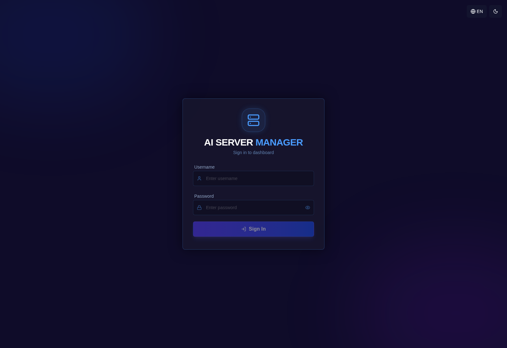
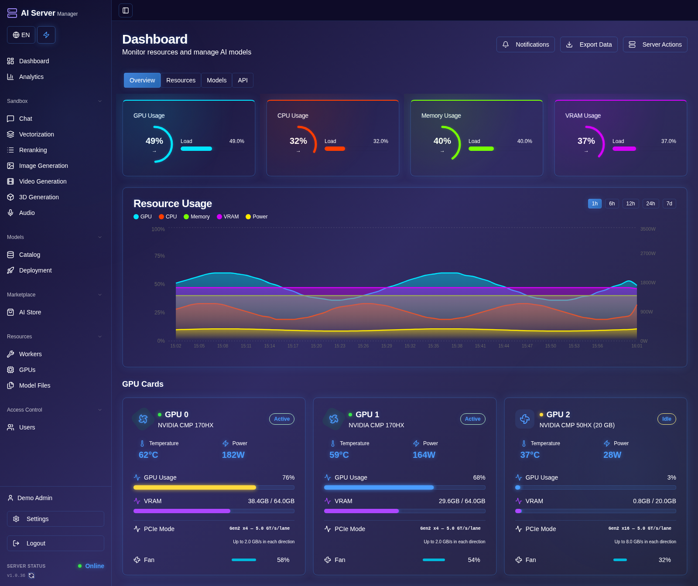
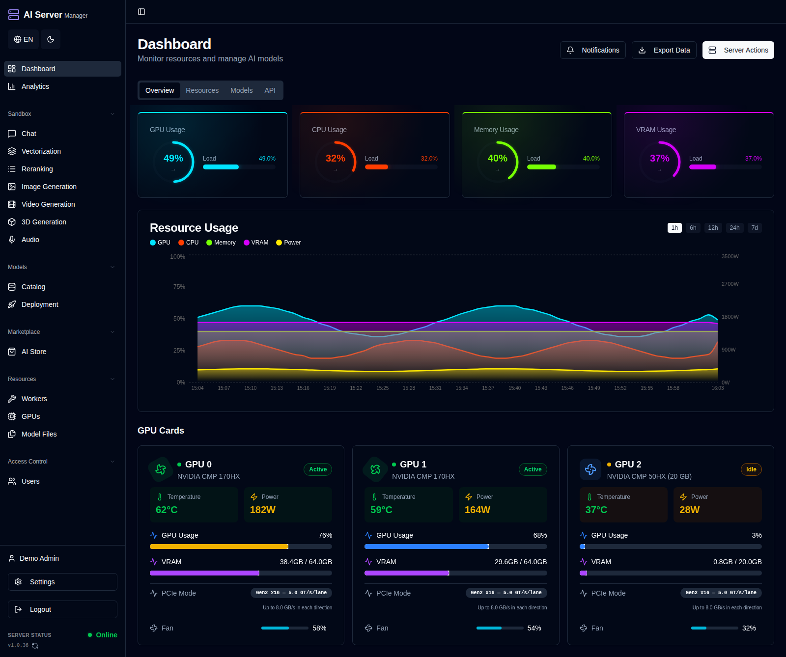

# AI Server Manager

[**Русская версия**](README.ru.md) · [**User documentation**](docs/en/README.md) · [Website](https://ai-server-manager.ru/)

**Run and manage AI on your own Linux server.** AI Server Manager brings model
downloads, GPU assignment, local inference, chat, media generation and automation
into one web interface.

This is the **public installation and user-documentation repository**, not the
application source repository. It contains no application source code, model
weights, license keys or service credentials. English is the primary language;
a separate [Russian guide](docs/ru/README.md) is available.

## What you can do

**Panel version 1.0.39 · documentation updated 24 November 2026.**
[Full capabilities](docs/en/features.md) · [Все возможности на русском](docs/ru/features.md)

- **Download and launch models:** categorized catalog, Hugging Face/ModelScope,
  selected components, resumable downloads, file verification, saved launch presets.
- **Choose an LLM engine:** vLLM, llama.cpp, QEngine, Hipfire, Strata or Avalon,
  with engine-specific formats and hardware requirements. 1Cat has been removed
  from the current offering.
- **Tune inference:** context, KV cache, placement/offload and supported prefix
  caching, CUDA Graphs, MTP or DFlash recipes. Long contexts require memory checks.
- **Chat and build projects:** streaming responses, supported multimodal input,
  coding tools, Linux commands/rg, revision-aware edits, subagents and loop guards.
- **Inspect code and documents:** browser preview, manual editing, PDF/DOCX/XLSX/PPTX
  reading, DOCX editing, and DOCX/PDF creation including multi-page PDF assembly.
- **Use your knowledge:** agent-specific AI Knowledge access, OCR, compatible
  embeddings/reranking and explicitly configured retrieval workflows.
- **Create images, video and 3D:** compatible FLUX, Qwen Image, Ideogram, Wan,
  MiniMax H3, LTX and TRELLIS.2 workflows, with saved outputs and project exports.
- **Work with speech:** STT/TTS engines, Transcriber Agent summaries, Voice Agent
  V1/V2 and experimental native Go V3, optional camera and personality settings.
- **Create ads, films and music clips:** Lite/Pro workflows where supported,
  scene/dialogue controls, character/product/place references and compatible LoRAs.
- **Train compatible LTX adapters:** AI LoRA Trainer, prepared photo/video datasets
  and reference-conditioned photo sets using a compatible image-generation model.
- **Operate GPUs and workers:** automatic/manual GPU assignment, supported multi-GPU
  and multi-server recipes, resource charts, model logs and controlled GPU Lab access.
- **Integrate and automate:** scoped API keys, compatible application endpoints,
  MCP, Telegram, schedules, LiveKit/SIP and permission-controlled plugins.
- **Manage updates and access:** user roles, subscriptions and a separate updater
  with recovery support.

Features depend on the installed image, model format, hardware, license and
permissions. Strata/Avalon routes, some long-context profiles, native H3 Turbo
and Voice V3 require additional testing. Presets are not speed, quality or memory
guarantees. Read the [compatibility notes](docs/en/features.md) before choosing.

## Interface preview

Existing English-language demonstration screenshots are retained. They were
captured before this documentation update and may differ from version 1.0.39.
They show **mock data**. GPU load, memory, models and
server details are illustrative, not benchmark results. No production accounts,
credentials or server addresses are shown.

### Sign in



### Dashboard — blue theme



### Dashboard — dark theme



## Plugin catalog

The catalog includes these **21 implemented plugin entries**. Availability and pricing
depend on your subscription, installed build and each plugin's requirements;
check AI Store in your panel for current access. Model weights are separate.

| Plugin | Purpose |
| --- | --- |
| **MCP Server** | Connect external AI agents to supported server and model-management tools |
| **Telegram Sentinel** | Remote server monitoring and control through a Telegram bot |
| **Realtime Voice Agent** | Interactive voice conversations with speech recognition and synthesis |
| **Cron Task Scheduler** | Scheduled tasks, model wake-ups, reports and maintenance |
| **SecOps Pentest Agent** | Defensive security assistant with persistent knowledge and controlled integrations |
| **Docker Manager** | Container status, logs, lifecycle actions and configuration |
| **Level 0 Support AI** | First-line support workflows and knowledge-assisted answers |
| **AI Chat Agent** | AI assistant with knowledge/RAG, web search and supported server tools |
| **Server Messenger** | Server messaging, rooms, group conversations and direct messages |
| **TG Commenter Pro** | AI-assisted Telegram commenting, accounts and schedules |
| **AiSharkOCR** | Document recognition and structured parsing in Lite, Vision and Hybrid modes |
| **Transcriber Agent** | Transcripts and LLM summaries; speaker labels when supported by ASR |
| **Object Detector** | Object detection and segmentation for images and cameras; custom training |
| **LiveKit SIP** | SIP telephony and voice-agent call integration |
| **AI Pearl Mining** | Mining runtime management, statistics, console and supported NVIDIA GPU tuning |
| **AI Knowledge** | Shared knowledge bases, RAG, document versions and access permissions |
| **AI Music Clip Creator** | Music-driven storyboards, scene generation and music-video export |
| **AI Ad Creator** | Product/person references, advertising scripts and video export |
| **AI Film Creator** | Short-film projects, scenes, dialogue, music, effects and export |
| **AI LoRA Trainer** | Compatible LTX adapter training, datasets and adapter jobs |
| **NeithOS GPU Lab** | Owner-authorized Hub diagnostics and GPU/container experiments |

**Planned / prototype catalog entries — not available as production plugins:**
Crypto/Stock Trader Analyst, Media Factory and DevOps Toolkit.

See the [plugin guide](docs/en/plugins.md) for setup and creative workflows.

## Creative workflows and access

Creative workflows include the following. Check the current AI Store and plan
for availability and pricing:

| Plugin | Purpose |
| --- | --- |
| **AI Music Clip Creator** | Music track → storyboard → H3/LTX scenes → exported music video |
| **AI Ad Creator** | Person/product photos and a script → advertising video, Reels or YouTube |
| **AI Film Creator** | Short-film projects up to 30 minutes, scene references, dialogue/TTS, music, sound effects and export |

They support saved projects, reusable character assets, queues and creative MCP
tools. Long films are assembled from short scenes, not generated in one request.
Actual quality, generation time and lip synchronization require verification.
See [Plugins](docs/en/plugins.md).

## Quick start

Use a Linux host with Docker/Compose and working GPU drivers where applicable.
Review the [installation guide](docs/en/installation.md) before proceeding.

Download the public entry point and read it before running:

```bash
curl -fL --proto '=https' --proto-redir '=https' \
  https://raw.githubusercontent.com/rjohny55/ai-server-manager/main/install.sh \
  -o install.sh
bash install.sh --help
bash install.sh auto --download-only
```

`--download-only` saves the current official installer as a new file for review.
It does **not** install anything. To install after review:

```bash
bash install.sh auto
```

You can select `nvidia`, `amd` or `cpu` instead of `auto`. Administrative
privileges may be required by the official installer. It creates the panel and
the separate updater and may install Docker. Do not run it blindly over an
existing production deployment.

The entry point retrieves the current installer from
`https://ai-server-manager.ru/api/install` using verified HTTPS. Review and run
the saved downloaded file if you need to execute exactly the version you inspected.
No license or account credentials are embedded in this repository.

## Documentation

Every chapter includes numbered instructions and localized demonstration screenshots.
Start with the [English guide](docs/en/README.md) or [Russian guide](docs/ru/README.md).

- [Installation and first login — 8 illustrated steps](docs/en/installation.md)
- [Model catalog, downloads and launch](docs/en/models.md)
- [GPU assignment and memory](docs/en/gpu.md)
- [Chat, agent and application API](docs/en/chat-api.md)
- [Images, video, audio and 3D](docs/en/media.md)
- [Plugins and creative projects](docs/en/plugins.md)
- [Music video walkthrough](docs/en/music-clip.md)
- [Product advertisement walkthrough](docs/en/ad-creator.md)
- [Film and trailer walkthrough](docs/en/film-creator.md)
- [Updates, licensing, backup and troubleshooting](docs/en/operations.md)
- [Security and support](docs/en/security.md)

## Links and licensing

[Project website](https://ai-server-manager.ru/) · [Online user guide](https://ai-server-manager.ru/docs) · [Neithos](https://neithos.ru/)

AI Server Manager is distributed under its product license. A public installer
and public documentation do **not** make the application open source. Third-party
engines and model weights have their own licenses; verify their terms before use.
See [NOTICE](NOTICE.md).

For support, open a GitHub issue with a sanitized description. **Never post
passwords, tokens, license strings, cookies, `.env` files or private documents.**
