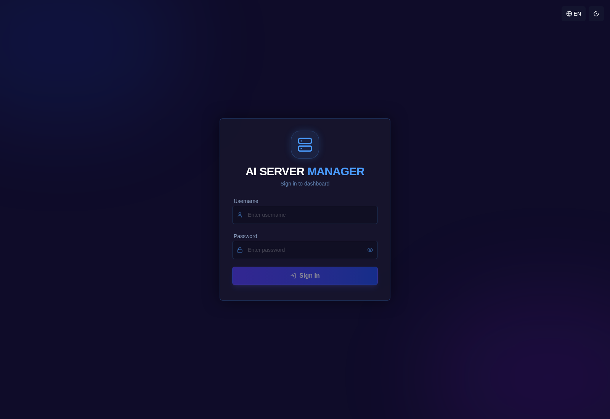
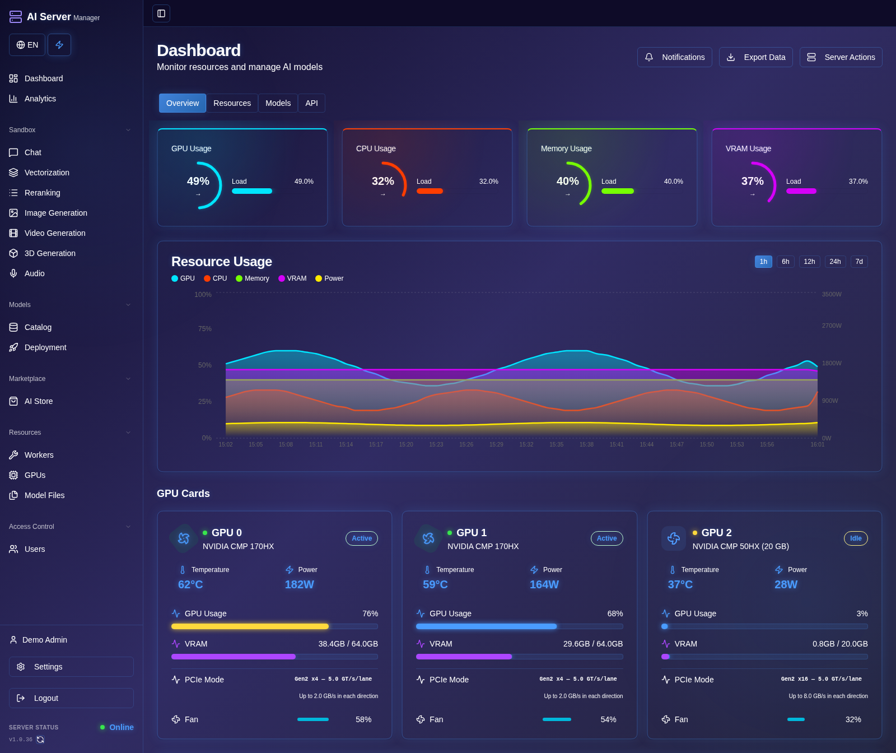
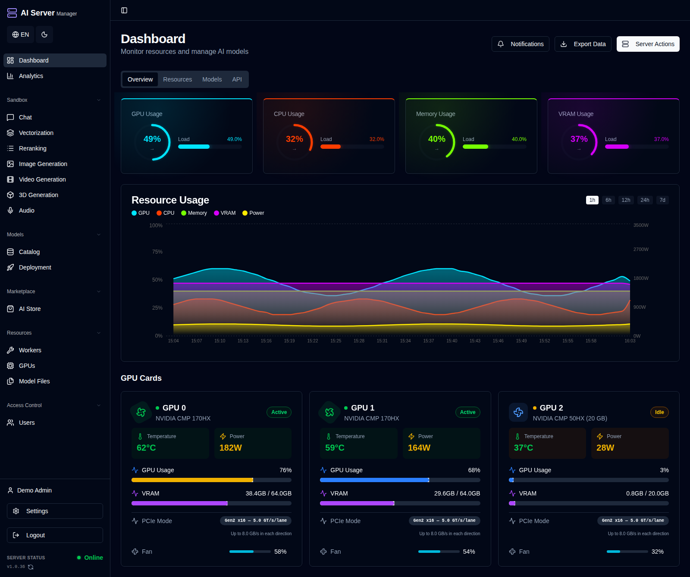

# AI Server Manager

[**English — primary version**](README.md) · [**Руководство пользователя**](docs/ru/README.md) · [Сайт](https://ai-server-manager.ru/)

**Запуск и управление ИИ на собственном Linux-сервере.** Каталог моделей,
скачивание, назначение GPU, локальный инференс, чат, генерация медиа и
автоматизация в одной веб-панели.

Это публичный репозиторий **установки и пользовательской документации**.
Исходники приложения, веса, лицензионные ключи и доступы здесь не публикуются.
Основная документация — [на английском](docs/en/README.md).

## Возможности

- Каталог LLM, изображений, видео, аудио и 3D; рекомендации по оборудованию,
  загрузки, сохранённые настройки запуска и пресеты.
- vLLM и llama.cpp; экспериментальные 1Cat-vLLM, Hipfire и Strata в подходящих
  вариантах образа.
- NVIDIA/AMD, автоматический и ручной выбор GPU, поддерживаемое движком
  распределение на несколько карт и CPU/RAM offload.
- Чат, агентные инструменты и превью кода.
- FLUX Klein, Ideogram, Wan, MiniMax H3 и LTX в поддерживаемых pipelines.
- Распознавание и синтез речи, OCR-плагины и специализированная генерация 3D.
- MCP, Telegram, расписания, база знаний/RAG и другие плагины.
- Мониторинг, права пользователей, API-ключи и отдельный обновлятор.

Функции зависят от образа, оборудования, весов и лицензии. Экспериментальный
пресет не гарантирует запуск или скорость на любой видеокарте.

## Интерфейс панели

Интерфейс на английском языке с **демонстрационными данными**. Загрузка GPU,
память, модели и параметры сервера показаны для примера, а не как результаты
тестов. Рабочие аккаунты, ключи и адреса серверов не показаны.

### Вход в систему



### Главная страница — синяя тема



### Главная страница — тёмная тема



## Список плагинов

В каталоге есть **19 реализованных плагинов**. Доступность и стоимость зависят
от подписки, установленной сборки и требований плагина. Актуальные условия
смотрите в AI Store внутри панели. Веса моделей скачиваются отдельно.

| Плагин | Назначение |
| --- | --- |
| **MCP Server** | Подключение внешних ИИ-агентов к инструментам управления сервером и моделями |
| **Telegram Sentinel** | Мониторинг и управление сервером через Telegram-бота |
| **Realtime Voice Agent** | Голосовые диалоги с распознаванием и синтезом речи |
| **Cron Task Scheduler** | Расписание задач, запуск моделей, отчёты и обслуживание |
| **SecOps Pentest Agent** | Помощник по защитной безопасности с базой знаний и контролируемыми интеграциями |
| **Docker Manager** | Состояние, логи, запуск, остановка и настройки контейнеров |
| **Level 0 Support AI** | Первая линия поддержки и ответы с использованием базы знаний |
| **AI Chat Agent** | ИИ-помощник с RAG, веб-поиском и инструментами сервера |
| **Server Messenger** | Сообщения, комнаты, групповые и личные чаты |
| **TG Commenter Pro** | ИИ-комментарии в Telegram, аккаунты и расписания |
| **AiSharkOCR** | Распознавание и структурный разбор документов: Lite, Vision и Hybrid |
| **Transcriber Agent** | Транскрибация аудио, разделение спикеров и резюме через LLM |
| **Object Detector** | Детекция и сегментация объектов на изображениях и камерах, обучение |
| **LiveKit SIP** | SIP-телефония и интеграция звонков с голосовым агентом |
| **AI Pearl Mining** | Управление майнером, статистика, консоль и поддерживаемые настройки NVIDIA GPU |
| **AI Knowledge** | Общие базы знаний, RAG, версии документов и права доступа |
| **AI Music Clip Creator** | Сценарий под музыку, генерация сцен и экспорт клипа |
| **AI Ad Creator** | Фото человека/товара, рекламный сценарий и экспорт видео |
| **AI Film Creator** | Короткометражки: сцены, реплики, музыка, эффекты и экспорт |

**Запланированные / прототипные записи каталога — не готовые рабочие плагины:**
Crypto/Stock Trader Analyst, Media Factory и DevOps Toolkit.

Настройка и творческие сценарии — в [руководстве по плагинам](docs/ru/plugins.md).

## Творческие плагины — без доплаты в Бизнес

В **Business и Enterprise без дополнительной платы за плагин** включены:

| Плагин | Назначение |
| --- | --- |
| **AI Music Clip Creator** | Музыка → сценарий → сцены H3/LTX → музыкальный клип |
| **AI Ad Creator** | Фото человека/товара и сценарий → реклама для Reels/YouTube |
| **AI Film Creator** | Проекты короткометражек до 30 минут, фото сцен, реплики/TTS, музыка, эффекты и экспорт |

Есть сохранение проектов, библиотека персонажей, очереди и creative MCP.
Длинный фильм собирается из коротких сцен. Качество, скорость и синхронизация
губ требуют отдельной проверки. Подробнее — [плагины](docs/ru/plugins.md).

## Быстрый старт

Подготовьте Linux, Docker/Compose и рабочие драйверы GPU. Прочитайте
[инструкцию установки](docs/ru/installation.md).

```bash
curl -fL --proto '=https' --proto-redir '=https' \
  https://raw.githubusercontent.com/rjohny55/ai-server-manager/main/install.sh \
  -o install.sh
bash install.sh --help
bash install.sh auto --download-only
```

Последняя команда только сохранит актуальный официальный установщик в новый
файл для проверки. После изучения можно выполнить именно сохранённый файл
или снова вызвать `bash install.sh auto` для актуальной версии.

Вместо `auto` доступны `nvidia`, `amd`, `cpu`. Официальному установщику могут
потребоваться права администратора: он создаёт панель и обновлятор, при
необходимости устанавливает Docker. Не запускайте его вслепую поверх рабочей
конфигурации. Скрипт загружается с `https://ai-server-manager.ru/api/install`
по HTTPS; действующие ключи в репозитории отсутствуют.

## Документация

- [Установка](docs/ru/installation.md)
- [Каталог и запуск моделей](docs/ru/models.md)
- [GPU и память](docs/ru/gpu.md)
- [Чат, агент и API](docs/ru/chat-api.md)
- [Изображения, видео, аудио и 3D](docs/ru/media.md)
- [Плагины](docs/ru/plugins.md)
- [Обновления, лицензии и диагностика](docs/ru/operations.md)
- [Безопасность и поддержка](docs/ru/security.md)

[Сайт проекта](https://ai-server-manager.ru/) · [Онлайн-руководство](https://ai-server-manager.ru/docs) · [Neithos](https://neithos.ru/)

Приложение распространяется по лицензии продукта. Публичные установщик и
документация **не означают публикацию исходников**. У движков и весов свои
лицензии; проверяйте условия использования. См. [NOTICE](NOTICE.md).

В обращениях GitHub не публикуйте пароли, токены, лицензионные строки, cookies,
`.env`, приватные документы и необработанные журналы с секретами.
