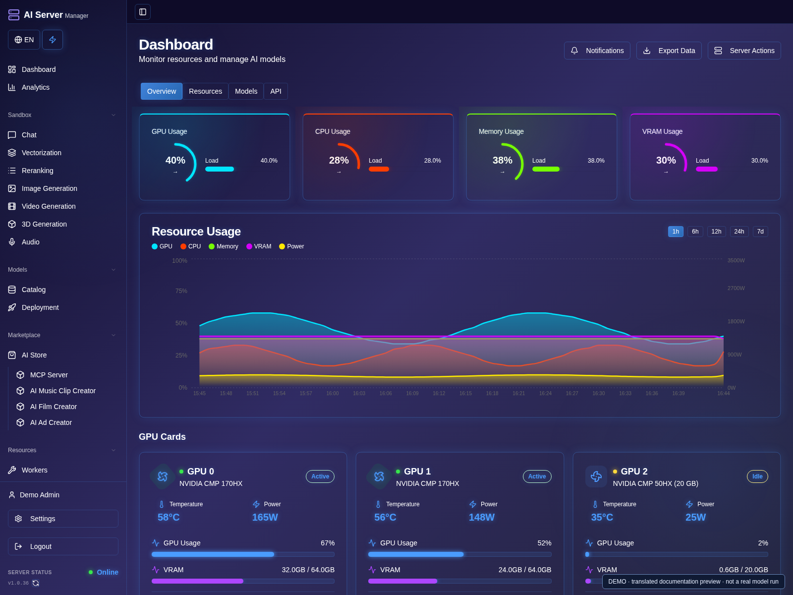

# User guide

[Русская версия](../ru/README.md) · [Project home](../../README.md)

For users of the packaged AI Server Manager application. No application build
or access to private source code is required.

1. [Installation and first login](installation.md)
2. [Catalog, downloads and launching models](models.md)
3. [GPU assignment and memory](gpu.md)
4. [Chat, agent and API](chat-api.md)
5. [Images, video, audio and 3D](media.md)
6. [Plugins and creative projects](plugins.md)
7. [Updates, licensing and troubleshooting](operations.md)
8. [Security and support](security.md)

## Start here

1. Complete [installation and first login](installation.md), then change your initial password.
2. Check detected GPUs, disk space and the license on the dashboard.
3. Follow the catalog and launch guide before opening Chat or a media workspace.

## About the screenshots

All eight chapters have numbered walkthroughs and screenshots. Panel images use
the actual interface on an isolated demonstration server with synthetic data.
English previews translate some labels that are not yet localized in the panel;
they do not announce an interface translation release. Console images are
illustrations. Version numbers, projects, GPU readings and account values are
examples, not measurements, real activation or completed model runs. No working
credentials are shown. Controls can differ between builds and permissions.
Use your own values and start with a small test.

## Understanding status

**Downloaded** means files are on disk, not loaded into GPU memory. **Ready**
means the engine has passed its readiness check. A listening port or a started
process alone is not proof that weights have loaded.

**Experimental** means a compatible integration or preset is available but the
specific workload may still need testing on your hardware. A preset is not a
speed or memory guarantee. Application version, engine runtime and model weights
are separate: upgrading the panel does not automatically upgrade CUDA/vLLM/ROCm.
