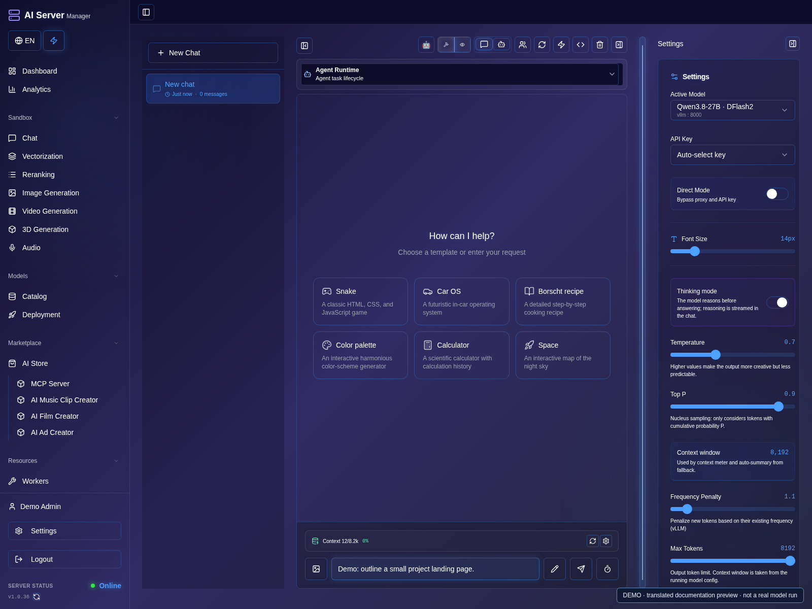
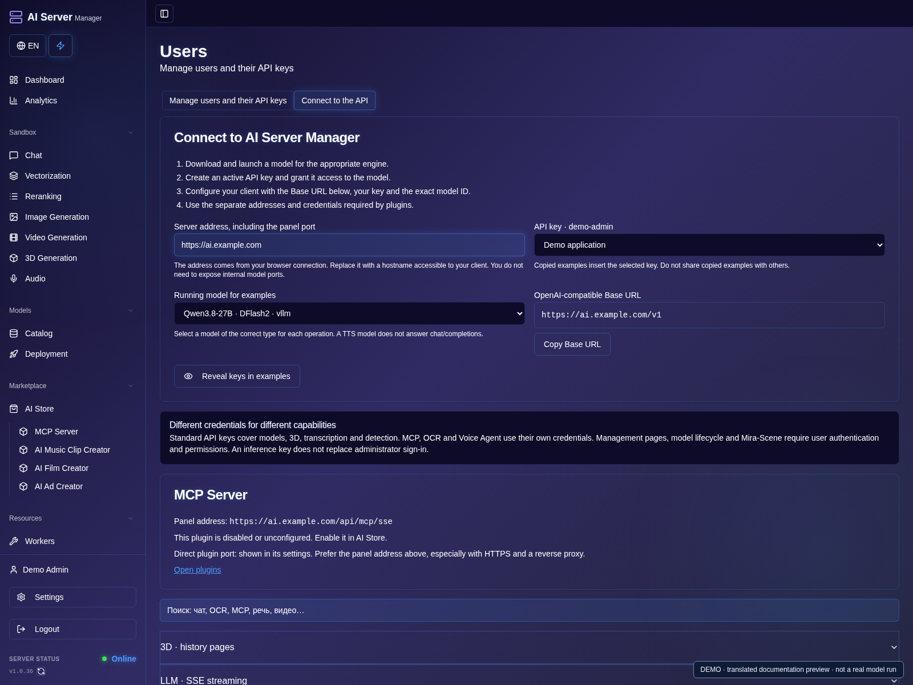

# Chat, agent and application API

[Guide](README.md) · [Русская версия](../ru/chat-api.md)

## Chat and agent

1. Launch a compatible LLM and wait for **Ready**.
2. Open **Chat**, select the running model and choose ordinary chat mode.
3. Type a short question and send it once. Check the model console if no answer arrives.



4. To work on files, switch to agent mode and select the intended workspace.
5. Describe a small task, review the plan/tool actions and inspect changed files.
6. Open a file explicitly to review code, then check the preview and save useful results.


These screenshots show prepared inputs, not a completed agent run.

Launch a compatible language model, select it in Chat and test a short message.
Attachments require a model and engine that actually support them. A separate
projector or vision component may be necessary.

Agent tools require a model with suitable tool-call support and the correct
launch settings. Start with a small task, review its plan, edits and results,
and check preview behavior before trusting generated work. A preview is not a
security audit or proof that generated software is production-ready.

If an operation is not confirmed, inspect the conversation/project and model
console before sending it again. Save important results outside temporary views.

## Connect an application

1. Open **Users / API keys** using an account with permission to manage keys.
2. Choose **Add API Key** and restrict model access, expiry and limits as needed.
3. Save it and store the issued secret securely. The example key on the screenshots is not usable.


4. Open **Connect to the API**, set the panel address accessible to your client and select a running model.
5. Copy the Base URL and the appropriate request example; keep the key private.
6. Verify the connection with a small request. Use a transcription, image or TTS model only for its supported API.



Create a dedicated API key in the panel with only the required permissions.
Record privately which application uses it; not every build offers a key-name field.
Use the panel's HTTPS address, not publicly exposed engine ports. Never commit
keys or use a copied browser session token as a permanent integration credential.

Obtain a model ID from `/v1/models` rather than guessing it from a filename:

```bash
curl --fail-with-body "$ASM_URL/v1/models" \
  -H "Authorization: Bearer $ASM_API_KEY"
```

`ASM_URL` and `ASM_API_KEY` are values you supply securely in your own environment;
this repository contains no working key.

Common endpoint families include `/v1/chat/completions`, `/v1/embeddings`,
`/v1/audio/transcriptions`, `/v1/audio/speech`, `/v1/images/generations` and
`/v1/video/generations`. Available fields and results depend on the engine/model.
OpenAI-compatible does not mean every model implements every endpoint.

MCP automation and specialized plugins may use their own credentials and
contracts. For accepted asynchronous jobs, check status using the returned job
ID instead of repeatedly creating new jobs. Treat 401/403 as access problems;
503 can indicate that the selected model is not ready yet.
