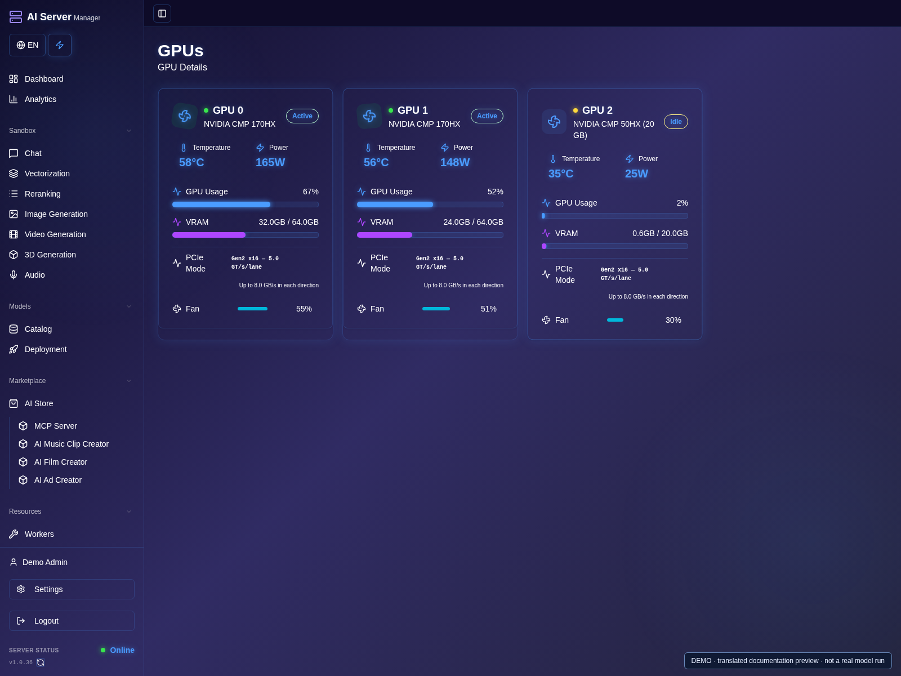
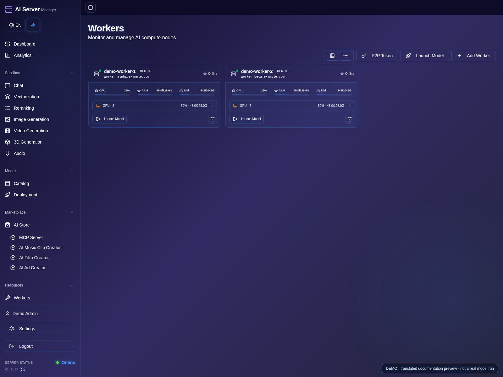
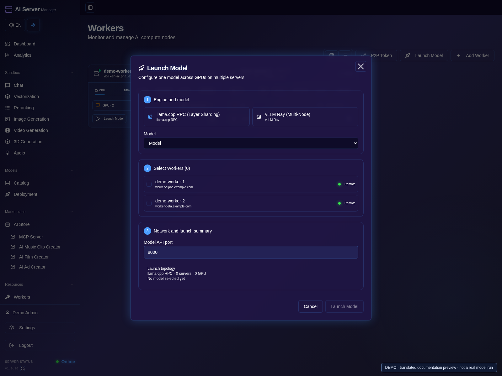

# GPU assignment and memory

[Guide](README.md) · [Русская версия](../ru/gpu.md)

GPU **selection** and model **distribution** are separate. Selection identifies
the cards to use; the engine determines how work and weights can be divided.
Two GPUs do not behave like one larger GPU for every model.

## Automatic and manual modes

1. Open **GPUs** and identify each card by its number, name, memory and PCIe information.
2. Compare these numbers with the model's launch settings, not with a runtime's renumbered device IDs.

3. Open the model settings. Keep automatic selection to let the panel choose eligible cards.
4. For manual placement, select the intended cards and review the engine's distribution settings.
5. Save, launch and check the assigned GPUs in the model card and console.

Automatic mode chooses cards at launch using managed model assignments and
reservations. A model that is still loading can already reserve a card. Available
memory is also checked; a process outside the panel may consume VRAM.

Manual mode lets you select specific cards. Check the saved assignments and
launch console if a model appears on a different card. Logical runtime GPU 0
can represent a different physical GPU after visibility filtering.

- llama.cpp tensor-split proportions apply to the selected cards. Relative
  values such as `30,70` are not vLLM tensor-parallel settings.
- vLLM parallelism must match a topology and model supported by that runtime.
- Hipfire and media engines have their own supported placement strategies.
- AMD Vulkan and ROCm are separate execution paths, not interchangeable flags.

## Multi-server clusters and P2P

1. Open **Workers** and check that your trusted servers are online and report their GPUs.
2. Use the supported worker connection/setup procedure; do not share registration credentials publicly.

3. Open **Launch Model**, select a compatible model and review the available deployment options.
4. Verify the target worker(s), engine and model files, then start a small test.
5. Confirm participating nodes in their statuses and logs; selecting one worker is not distributed inference.

Connect trusted worker servers through the panel's P2P/Workers functions to
monitor remote GPUs and coordinate supported model deployments. llama.cpp RPC
can distribute model layers across workers; vLLM/Ray provides supported
multi-node inference configurations. A vLLM tensor-parallel launch on one
worker is not, by itself, a multi-server deployment.

Compatibility depends on the model, engine build, GPU topology and network.
Prepare compatible runtimes and the required model files on participating
nodes, and test a small workload first. Adding servers does not automatically
pool all CPU, RAM or VRAM, or guarantee higher generation speed.

P2P here means communication **between servers**, not GPU-to-GPU PCIe peer
access. Use trusted nodes and protected network access; keep registration and
control credentials private.

## Memory and offload

1. Start with a hardware preset and a short context or small media output.
2. If supported, enable CPU/RAM offload and check available system RAM as well as VRAM.
3. Run one request, inspect peak memory and only then raise the workload.

Weights, KV cache, temporary activations, encoders and decoding can all consume
memory. The total VRAM across cards is not a guarantee that an indivisible
component fits. CPU/RAM offload moves storage or computation according to the
pipeline; it does not eliminate GPU memory requirements.

Start with a small context or short low-resolution generation. Test each model
individually before running multiple workloads on the same cards. A low compute
graph during file loading or text encoding is not proof of a stalled engine.

Choose a precision supported by the hardware and checkpoint. Turing/CMP50 and
MI50/gfx906 generally need FP16-compatible routes rather than BF16 settings.
Changing a compute setting does not convert a BF16 GGUF file into F16 weights.
