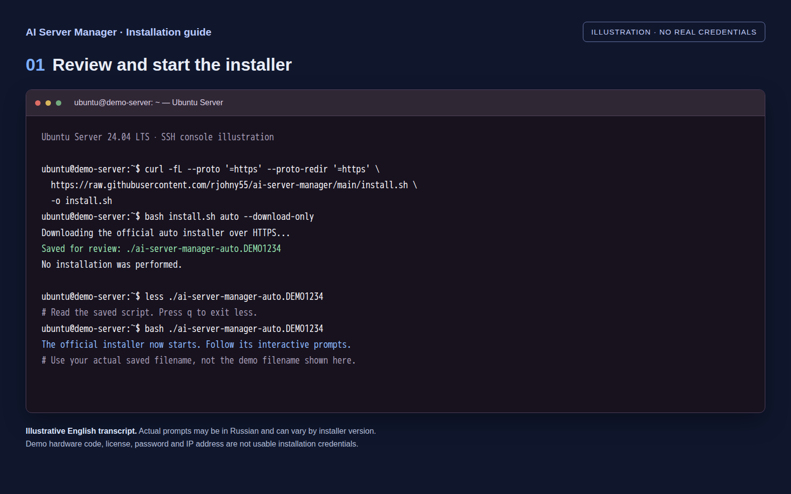
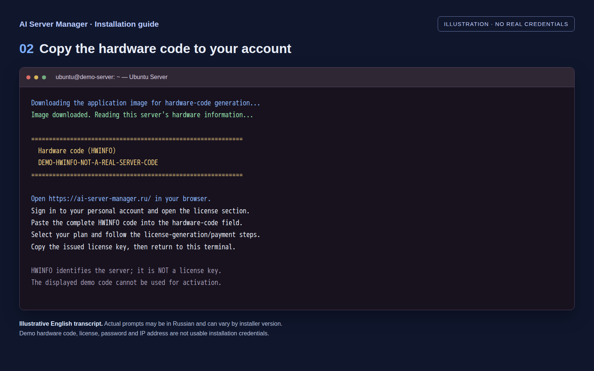
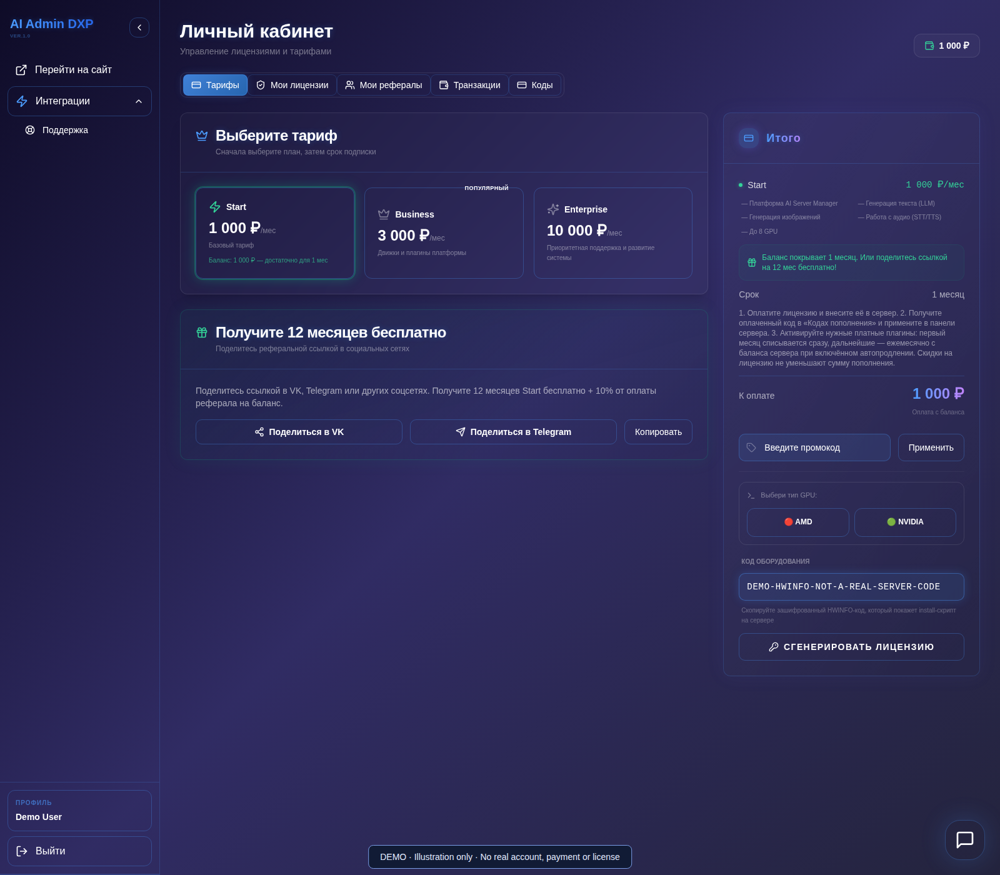
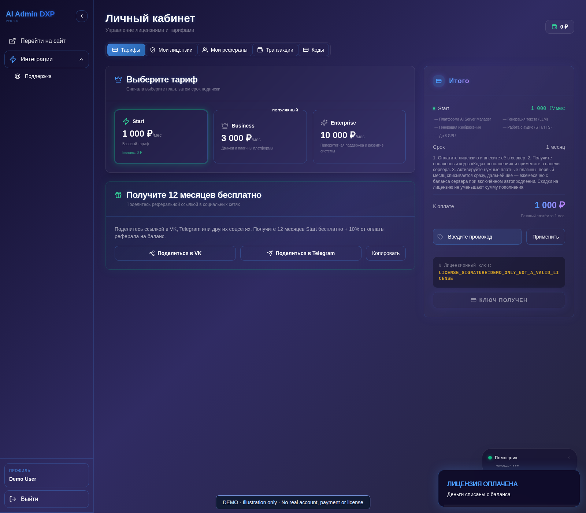
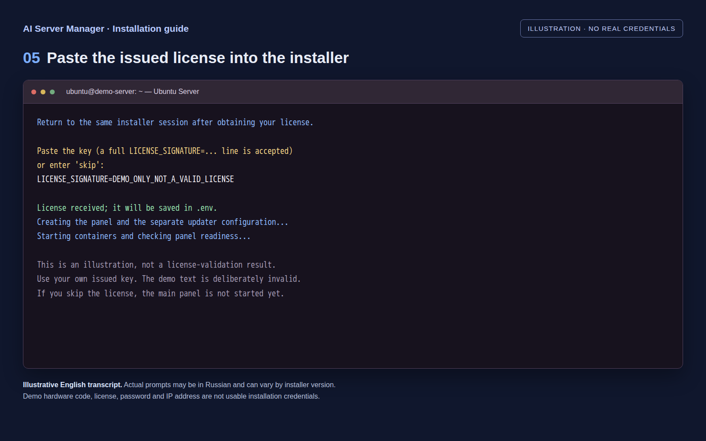
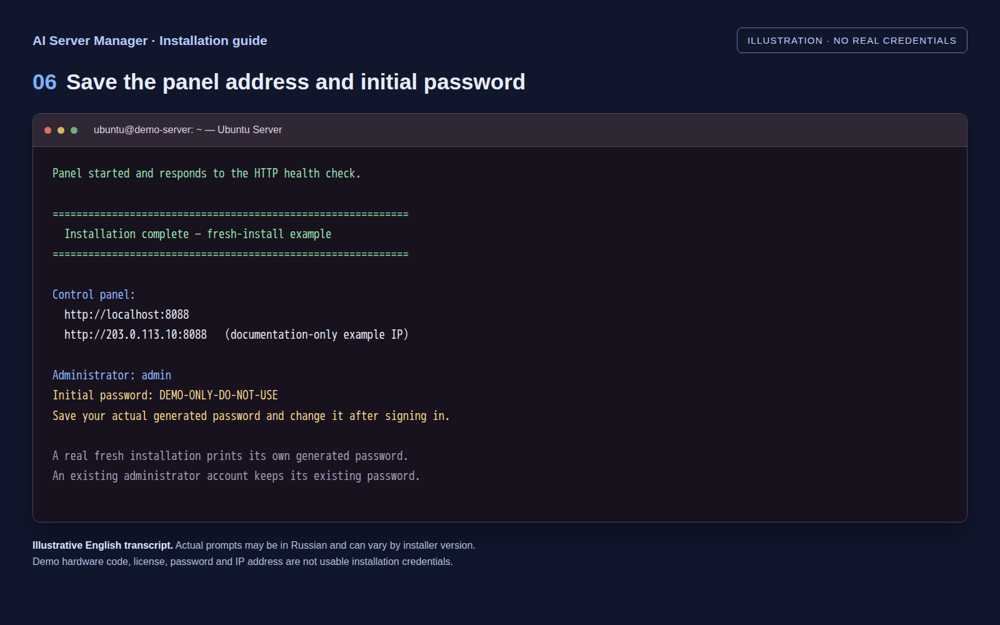

# Installation and first login

[Guide](README.md) · [Русская версия](../ru/installation.md)

## Prepare a host

Use a Linux machine with sufficient disk space and RAM, working Docker/Compose
and the appropriate GPU drivers. NVIDIA containers require a configured NVIDIA
Container Toolkit; AMD requires the appropriate GPU device access. A container
image does not repair host drivers or apply hardware unlocks.

Allow space for the application image, selected checkpoints, download/extraction
temporary files and generation results. Checkpoint size is not peak VRAM use.
CPU offload requires free system RAM and still needs VRAM for computation.

## Illustrated installation — eight steps

All screenshots below use **demonstration data**. The console images are
illustrative English transcripts, not evidence of a real installation. Actual
installer messages can be in Russian and vary by version. The personal-account
screens show the actual interface with mock API responses; no real license was
issued and no payment was made. The demo HWINFO, license, password and IP address
are deliberately unusable. **Use your own values, never those in the pictures.**

### 1. Download, review and start the installer in Ubuntu Server

Connect to your Linux server through SSH or its local console. Download the
repository's public [install.sh](../../install.sh):

```bash
curl -fL --proto '=https' --proto-redir '=https' \
  https://raw.githubusercontent.com/rjohny55/ai-server-manager/main/install.sh \
  -o install.sh
bash install.sh --help
bash install.sh auto --download-only
```

The last command downloads the current official installer over HTTPS but does
not execute it. Open the **exact saved filename** printed by that command in
`less`, read it, press `q`, then run that saved file with `bash`. The filename in
the screenshot is an example, not a file that exists on your server.

The entry point supports `auto`, `nvidia`, `amd` and `cpu`. Check the detected
hardware/image family. Review the installer before granting administrative
privileges: it may install Docker and creates both the panel and updater.
Do not run it over an existing deployment without a backup and migration plan.



### 2. Copy the server's HWINFO code

Follow the installer prompts. It downloads the selected image and obtains the
server's encrypted **hardware code (HWINFO)**. Copy the complete code from your
own terminal without line breaks. HWINFO is used to request a license; it is
**not** the license key itself. Keep this installer session open.



### 3. Paste HWINFO into your personal account

Sign in to the [project website](https://ai-server-manager.ru/) and open your
personal account (**Личный кабинет**) → **Тарифы**. Choose the plan and term;
paste HWINFO into **Код оборудования** and select **Сгенерировать лицензию**.
The following screen uses the site's Russian-language labels.



### 4. Obtain and copy the issued license

Complete any payment or eligibility steps required by your selected plan. An
unpaid license can display a masked key; do not paste that masked value into the
installer. Once the complete key is available, copy the license value or the
whole `LICENSE_SIGNATURE=...` line. **Ключ получен** marks the issued-key state
shown below. Your website account is separate from the local panel's `admin`.



### 5. Paste the license into the waiting installer

Return to the same server console and paste your own issued key when prompted.
The installer accepts the key alone or the complete `LICENSE_SIGNATURE=...`
line and saves it in the protected `.env`. The installer accepting the text is
not a substitute for the application's license validation.

If you choose `skip`, configuration can be prepared, but **the main panel is not
started yet**. Follow the installer's instructions to add the license and start
it; do not expect the login page until that is done.



### 6. Save the panel address and initial administrator password

Wait for the installer's readiness check and completion message. On a fresh
installation with an automatically generated password, the output shows the
local administrator `admin`, your initial password and the panel addresses.
Use the server's actual address and printed port, usually `8088` for this
installer. `localhost` opens the server only when your browser runs there; from
another computer use the server address instead.

Save the password privately. If you supplied `ADMIN_INITIAL_PASSWORD` yourself,
use that value. An existing account keeps its existing password; rerunning the
installer or changing an environment variable does not reset it.



### 7. Sign in to the local panel

Open the printed panel address in your browser. Enter `admin` and **your actual
initial password**, then select **Sign In**. This is not your website-account
password. Change the initial password after signing in. No real password is
shown in the screenshot.


### 8. Verify the dashboard and GPUs

Check the license, detected GPUs, VRAM and persistent storage. The example below
shows mock CMP 170HX and modified 20 GB CMP 50HX cards; it is not a benchmark or a
promise of your hardware's link speed. Test a small compatible model with one
request before downloading large models.


## Keep image families separate

| Hardware | Selection considerations |
| --- | --- |
| NVIDIA Turing / CMP50HX | Use a compatible Turing image and FP16-compatible recipes. Modified 20 GB CMP50HX cards are distinct from stock cards. |
| NVIDIA Ampere / CMP170HX and newer supported GPUs | Select the appropriate NVIDIA runtime and model preset. |
| AMD, including MI50/gfx906 | Use an AMD image; ROCm runtime families are not interchangeable. |
| CPU | Check that the selected model and engine support CPU execution. |

Confirm that your intended image tag and architecture are actually published.
Some newer integrations require a newer image build, not merely the same version
number. Do not select an `-updater` tag as the main application image.

## After installation

Restrict access to the local network until HTTPS, authentication and permissions
are configured. Never publish your HWINFO, license, initial password, cookies or
unredacted installation logs in issues or screenshots.

Keep Compose, environment files, data, models and updater state outside the
container and include them in protected backups. Never upload those files here.
