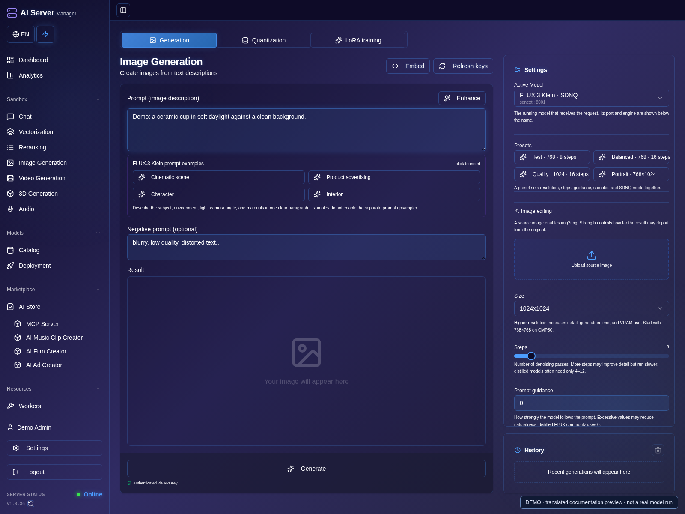
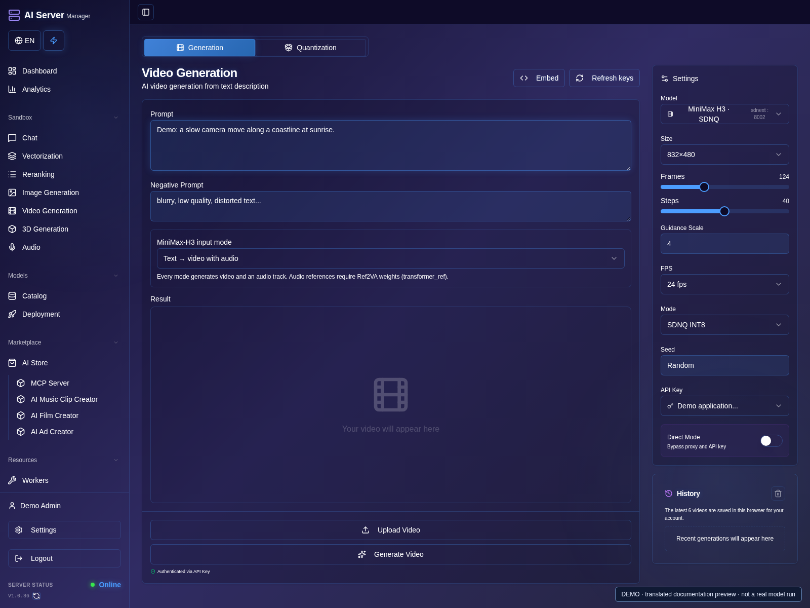
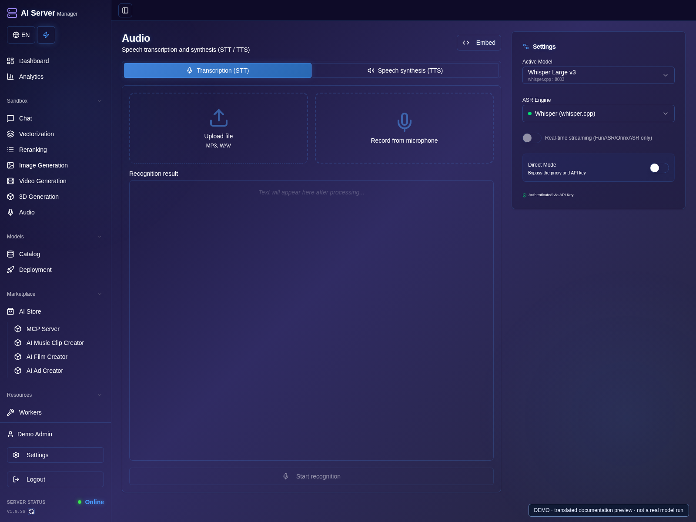
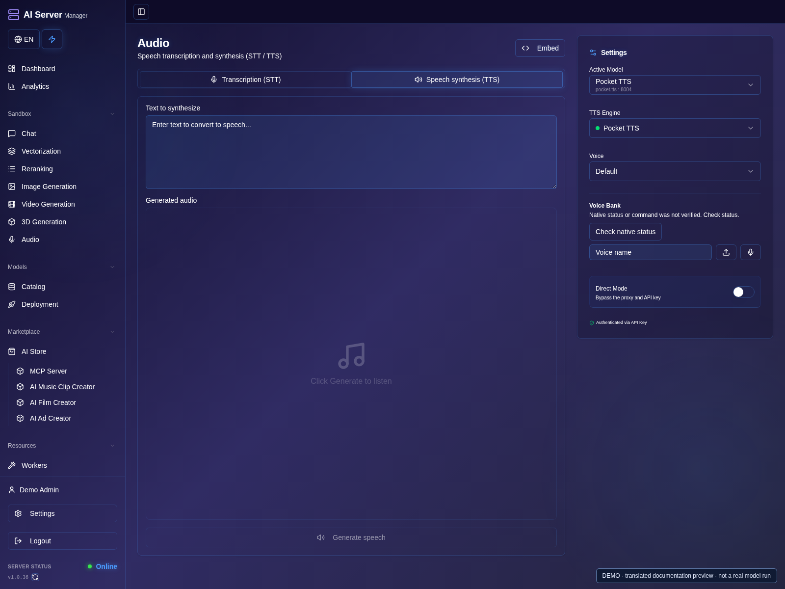
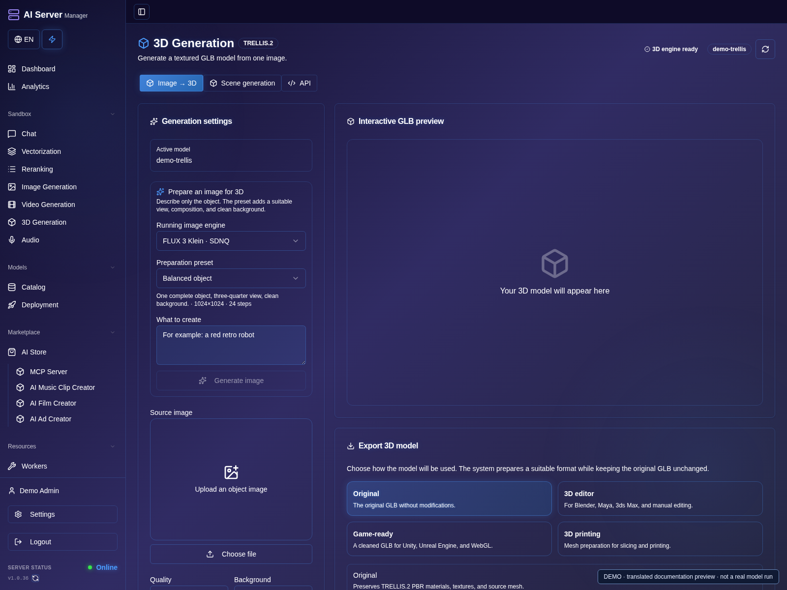

# Images, video, audio and 3D

[Guide](README.md) · [Русская версия](../ru/media.md)

## Images

1. Open image generation and choose a ready image model.
2. Select a test preset or enter a prompt; review width, height, steps and seed.
3. Add a reference only for a compatible workflow. Leave prompt enhancement off unless its LLM is configured.
4. Generate once, wait for completion, open the result and download it.

Select a supported image model and complete pipeline, apply its hardware preset,
launch it and wait for readiness. Then choose the running model in image
generation. Supported integrations include FLUX Klein and Ideogram workflows.

Set prompt, dimensions, steps and seed. Use compatible reference-image/editing
weights where needed. Prompt enhancement is optional and requires a selected
compatible language model; it is not required for ordinary image generation.

SDPA, FlashAttention, SageAttention and xFormers are alternatives subject to
hardware and pipeline support. Selecting all optimizations is not required.
Use a compatible SDPA preset as a diagnostic baseline.

## Video

1. Open video generation and select a ready Wan, MiniMax H3 or LTX model.
2. Choose the correct input mode and preset. Add an image/audio reference only if the checkpoint supports it.
3. Check duration, resolution and other visible parameters; begin with a short, low-cost test.
4. Start generation, wait for the job to finish, then play and download the result from history.

Supported workflows include Wan, MiniMax H3 and LTX. Select a preset for the exact
checkpoint, hardware and input mode: text, image reference and audio reference
are not interchangeable. Keep reference components if you intend to use them.

Start with a short clip and modest resolution. Frame-count and dimension
constraints vary by pipeline. More frames, resolution and quality can greatly
increase memory use and render time. Multi-GPU and CPU offload work only in
supported configurations; a memory estimate is not a guarantee.

Some H3/LTX workflows generate video with audio. This is not a universal service
for adding sound to every existing video. Use [creative plugins](plugins.md) for
project-based scenes and sound editing.

## Audio and 3D

### Transcribe audio

1. Launch a supported speech-recognition model, then open **Audio**.
2. Select transcription and the running model; upload a short supported audio file.
3. Choose the available language/output options and start transcription.
4. Review the recognized text and timestamps, if supported, before saving or using them in a project.

### Synthesize speech

1. Switch to **Speech synthesis (TTS)** and select a running TTS model.
2. Enter a short phrase and choose a supported voice or reference.
3. Start synthesis, listen to the result and download the audio.

### Generate 3D

1. Launch the required 3D model and open **3D generation**.
2. Select the model, add its required input image and review available settings.
3. Submit one job and wait for completion; inspect the preview and available export formats.
4. Download the finished asset and review geometry/materials before using it elsewhere.

Speech recognition and synthesis require their own supported models. Language,
voice cloning, timestamps, diarization and streaming depend on the chosen engine.
Test a short file or phrase first. Obtain permission before using another person's
voice or image.

OCR plugins and specialized 3D integrations have separate models and jobs.
A video-generation model is not a 3D generator, and video analysis is not video
generation. Wait for an asynchronous job to finish before downloading its result.

## Results and history

1. After a successful job, find its thumbnail in that workspace's history.
2. Open the image for a larger view or the video for playback, then use **Download**.
3. When returning to a workspace, check the same user and project before submitting the job again.
4. Export important files and back up persistent data. An empty demo history on these screenshots is intentional;
   no sample output was generated for this guide.

Use persistent data storage for generation history and projects. Switching tabs
should not require deleting or re-downloading models. Inspect an existing job
before repeating a request with an unknown outcome. Export important images,
videos and project assets and include persistent data in backups.

Some workspaces keep their recent-history list in the browser; the video screen
shown here lists the latest six videos for this browser/account. Clearing site
data or using another browser can remove that list even when output files remain
on the server. A recent-history list is not a backup of the generated files.
