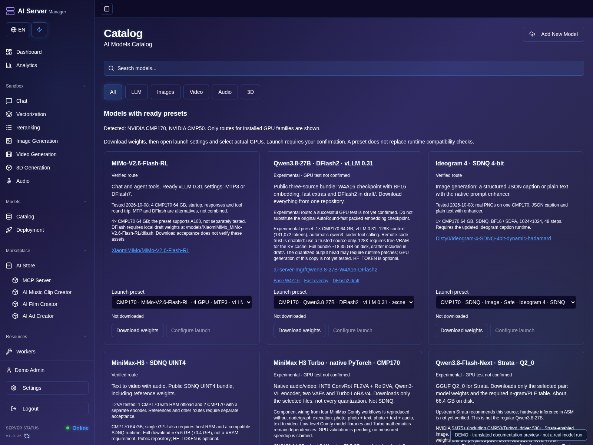
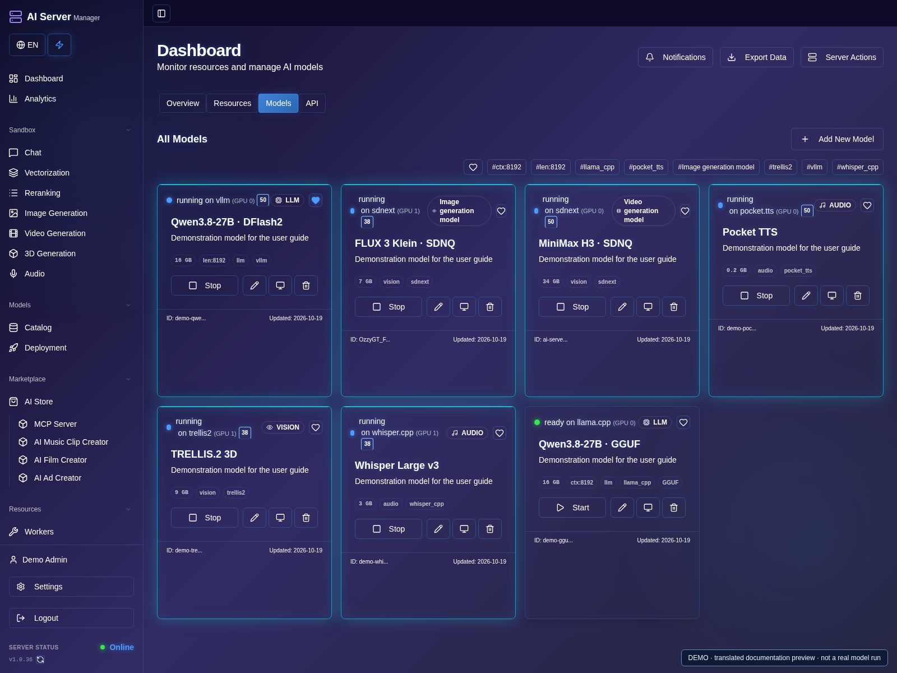
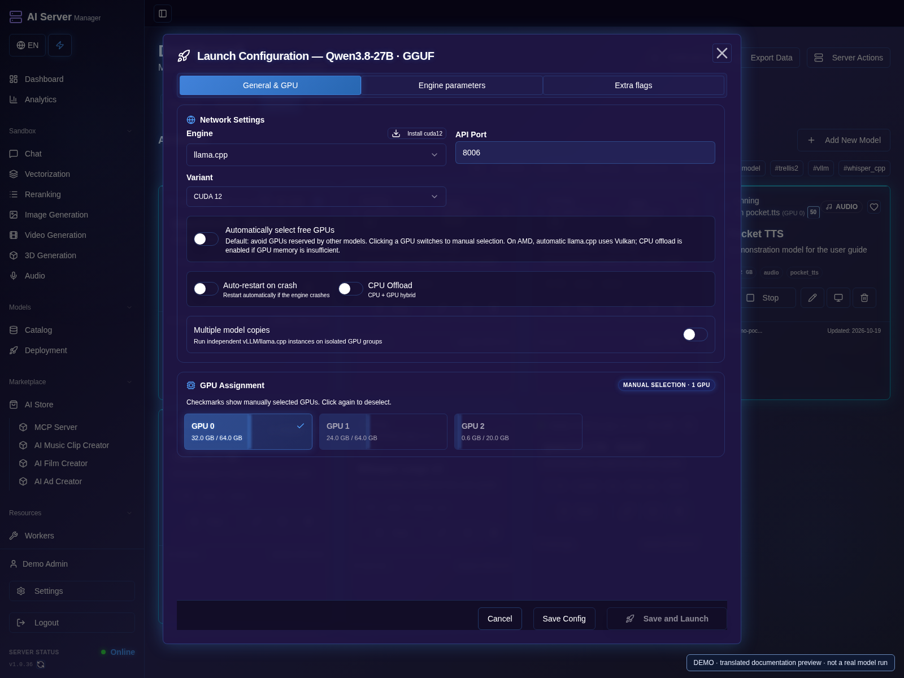
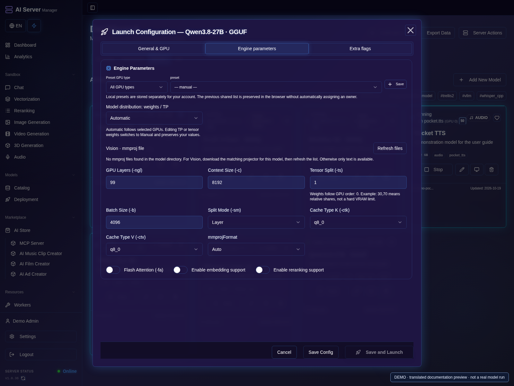

# Catalog, downloads and launch

[Guide](README.md) · [Русская версия](../ru/models.md)

The catalog groups LLM, image, video, audio and 3D models. Recommendations can
be filtered by detected hardware. A CMP170 preset is not automatically suitable
for CMP50; native Hipfire weights are not generic GGUF files.

## Download a complete model

1. Open **Catalog**, choose LLM, image, video, audio or 3D and review the hardware filter.
2. Open the model card and read its engine, memory requirements and license.
3. Start the download; include required components and draft/reference weights.
4. Watch download progress, then open **Launch** (**Deployment** in the English preview) when the files are available.

- **llama.cpp:** compatible GGUF and all required shards; a compatible projector
  is needed for supported vision models.
- **vLLM / 1Cat:** a supported checkpoint, tokenizer and configuration. Speculative
  decoding may require a separate draft model.
- **Hipfire:** a native compatible model package, not a renamed GGUF file.
- **Strata:** the format and complete shard set required by its preset.
- **Image/video pipelines:** all required components, not just transformer weights.
- **ASR/TTS:** the exact package format expected by the selected engine.

For gated Hugging Face models, accept the model's terms using your own account
and supply a token with the required read access. Model licenses apply separately
from your application subscription.

Download progress covers the selected file set. If the outcome of a request is
unknown, check existing downloads before retrying. Stopping a download and
deleting its files are different operations. Use disk synchronization for files
copied outside the application or to recover metadata.

## Launch

1. Open settings on the downloaded model's card.
2. Select the engine, compatible weight file and hardware preset.
3. Review context length, precision, attention backend and memory settings.
4. Select automatic or manual GPU assignment; see [GPU guidance](gpu.md).
5. Save and launch, then open the model console.
6. Wait for readiness and test one small request before increasing workload.

### Review engine settings

1. In the same dialog, open **Engine parameters**.
2. Choose values supported by the selected engine. For llama.cpp, review the
   weight file, context and GPU/offload settings; vLLM uses different parallelism controls.
3. If you need extra flags, use the engine-specific list, then review the saved values.
4. Save and launch once. Check the console and card state before repeating an unconfirmed request.

Long contexts, higher image resolution and concurrent requests increase memory
requirements. Enable remote model code only for a repository you trust; this
option executes code and does not fix an incompatible checkpoint.
