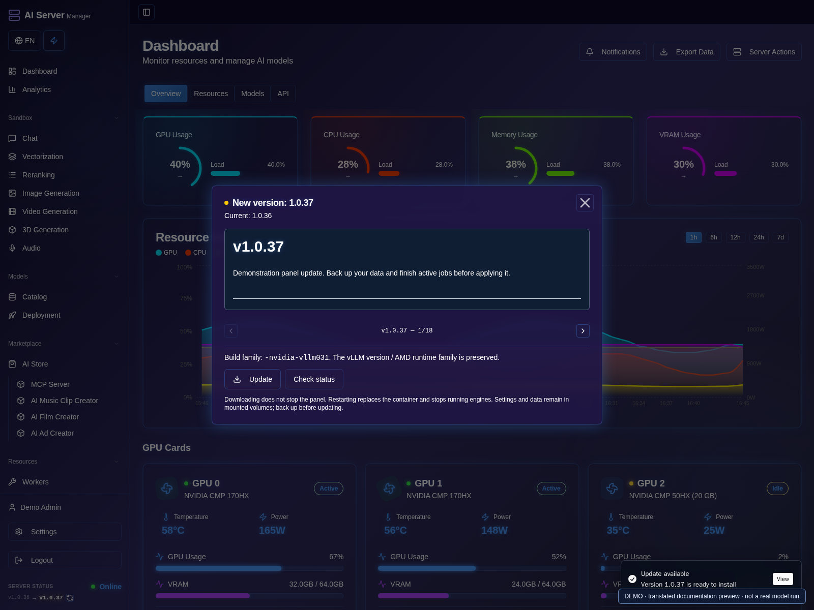
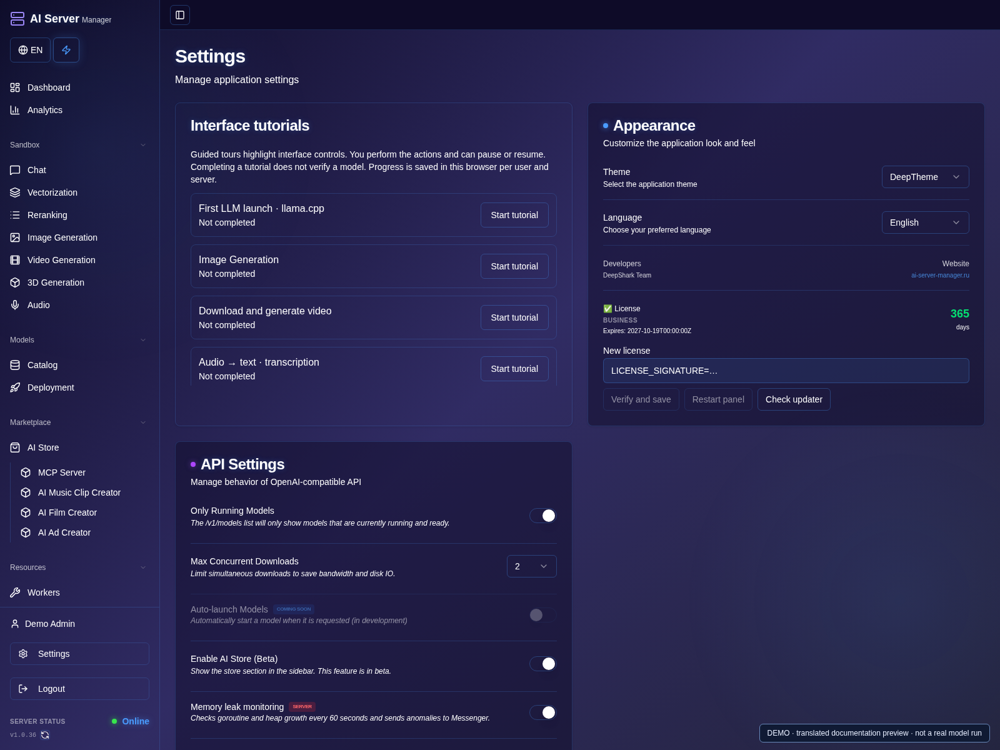

# Updates, licensing and troubleshooting

[Guide](README.md) · [Русская версия](../ru/operations.md)

## Updates and recovery

1. Open **Settings** to check the current interface and license status.
2. Finish active jobs and create a backup before replacing the container.

3. Open the version/changelog window from the sidebar and read the release notes.
4. Choose **Update** and check updater status. Review progress; if no newer image is found, there is nothing to apply.
5. Use the restart/apply button only when the updater reports the download ready.
6. After restart, check panel health, model settings and any rollback notification.

Version **1.0.37** in this image is a demonstration response, not a release announcement.

### Replace a license

1. In **Settings**, scroll to **License** and review the current plan and expiry.
2. Enter your own new license and choose **Verify and save**.
3. Check the returned plan and validity period. Do not restart with an invalid or unconfirmed license.
4. Check updater availability, then use the confirmed **Restart panel** action.

The panel and updater are separate containers. The updater provides a recovery
interface if the main panel is unavailable. Configure it according to the
installer output, restrict it to trusted local access and change its initial
password promptly. Do not expose its control API to the internet.

Open the panel version/changelog window to check for updates. Downloading an
update is not the same as applying it. Keep the same image family: NVIDIA
runtime generations and AMD ROCm lines are not ordinary interchangeable panel
updates. Review readiness and rollback status after applying an update.

To replace a license, use the license controls in Settings, validate and save,
then apply the confirmed restart action. An invalid license must not be applied.
If saving is unconfirmed, inspect updater status before retrying.

## Backups

1. Finish or pause writes using the relevant application's documented procedure.
2. Back up persistent data and deployment configuration to a protected location.
3. Check that project files and required settings are included, then test restoration separately.
4. Keep the previous working image/configuration until the update is verified.

Back up data, model metadata, projects, Compose/environment configuration and
updater state. Protect backups as secrets: they can contain credentials. Verify
restoration and file ownership. Restarting a container does not reread changed
environment configuration; use the documented updater procedure.

## Common problems

1. Open the affected model's console or the updater's operation status.
2. Find the first meaningful error and match it with the checks below.
3. Correct one setting at a time; do not delete weights or persistent volumes just to retry.
4. If needed, submit a sanitized [support report](security.md).

| Symptom | Check |
| --- | --- |
| Engine process exists but no response | Weight loading, readiness and the first real error in its console |
| HTTP 503 during loading | Whether loading is ongoing or has failed; do not restart repeatedly |
| Memory error with CPU offload | Free RAM, per-component VRAM, context/resolution and the selected offload mode |
| Wrong GPU appears active | Saved assignments and logical-to-physical mapping; see [GPU](gpu.md) |
| Download/launch result unknown | Existing job/model state before retrying |
| History seems missing | Correct user, project, persistent data mount and job result |
| Panel unavailable after update | Updater operation, readiness and rollback outcome |
| Missing GPU device in Compose | Real host devices and the correct installer/runtime family |

Check free space on the filesystem that actually stores Docker data and models.
Deleting an image tag does not necessarily free shared layers. Do not run broad
volume/cache cleanup commands blindly: volumes may contain your projects or
models. See [safe support reporting](security.md).
