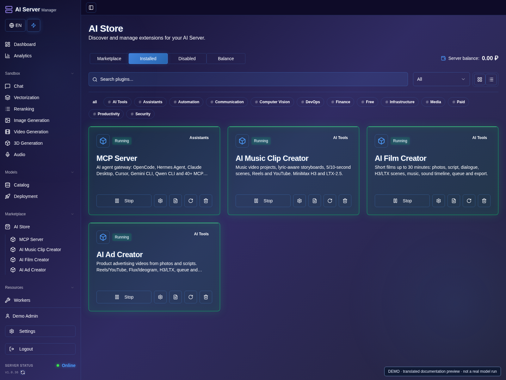
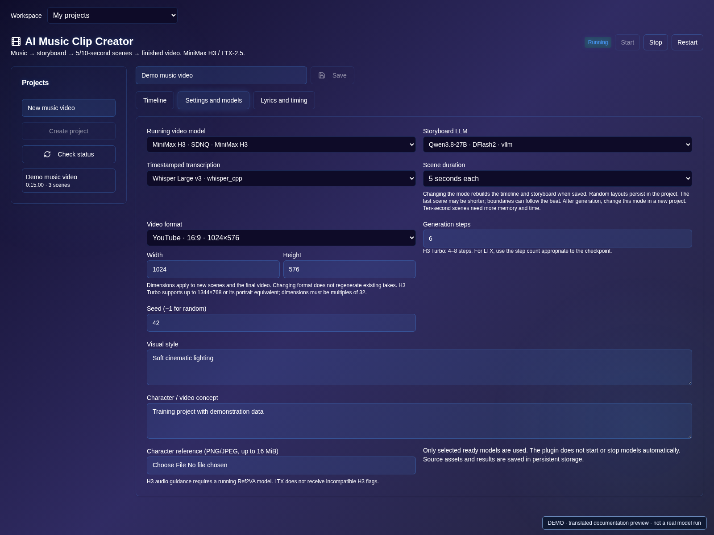
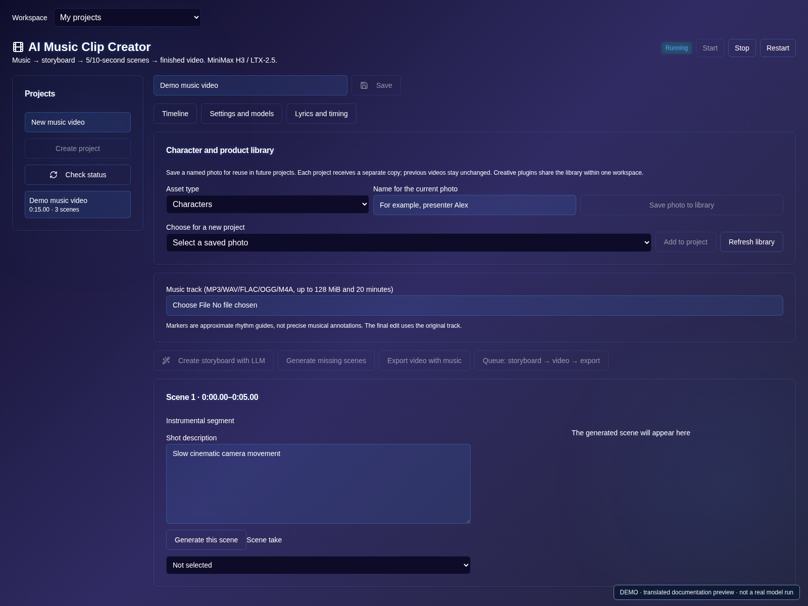
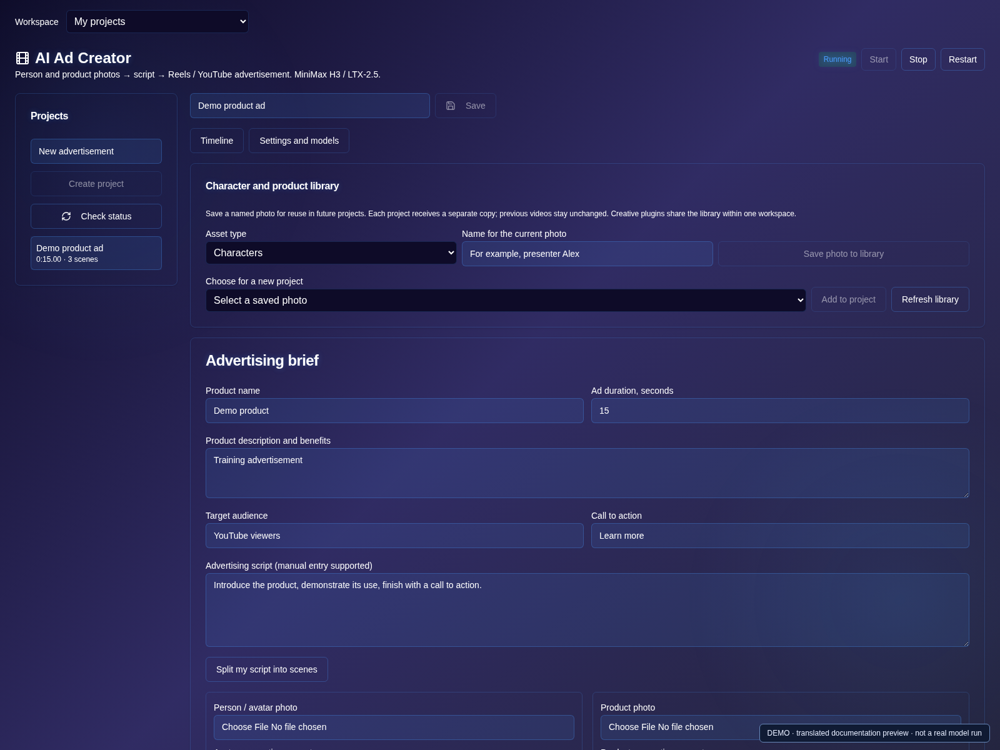
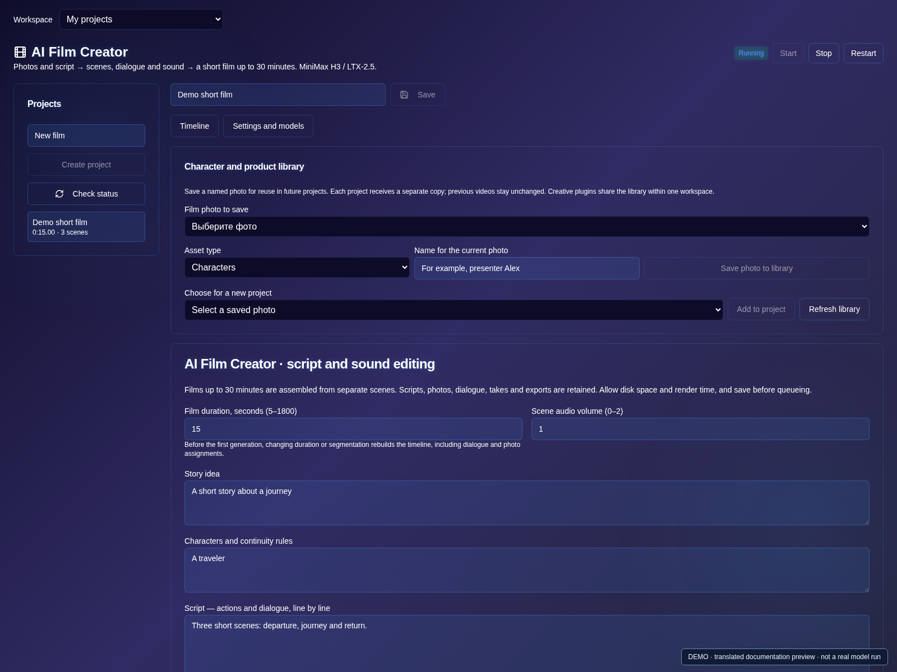

# Plugins and creative projects

[Guide](README.md) · [Русская версия](../ru/plugins.md)

For the complete catalog of 19 implemented plugins and three separately marked
planned entries, see the [plugin list](../../README.md#plugin-catalog).

Enable supported plugins in AI Store and grant appropriate user permissions.
Free/included plugins require the applicable subscription; **Business and
Enterprise include Music Clip Creator, Ad Creator and Film Creator without an
additional plugin charge**. Other plugins can have different pricing.

Availability depends on the installed image build. Model weights are downloaded
separately. Start the required video, image, language or speech models in the
model-launch section before selecting them inside a plugin.

## AI Music Clip Creator

### Enable a plugin

1. Open **AI Store**, review availability and subscription requirements.
2. Enable the plugin, wait for its running state and open its workspace.
3. Start compatible models in **Launch** first; enabling a plugin does not load model weights.

### Build a music video

1. Create a project and upload your music track.
2. Open **Settings and models**. Choose a ready H3/LTX model and optional storyboard LLM and timestamped ASR.
3. Choose 5-second, 10-second or mixed segmentation, format and test resolution; save.

4. Review lyrics/timing and generate or edit a storyboard.
5. Select a scene, edit its prompt and generate one take before queueing the rest.
6. Choose the desired take for each scene and export the clip with music.

Upload a track, choose H3/LTX and optionally an LLM/ASR model. Review transcript
and storyboard, use 5-second, 10-second or mixed scene lengths, and generate
shots. Select takes and export. The final soundtrack is the original music.

## AI Ad Creator

1. Create an advertising project and enter the product, audience, benefits and call to action.
2. Upload a person/avatar and product photo, or prepare permitted assets with a running image model.
3. Enter a script or use the selected LLM; review the scene breakdown.
4. In project settings choose ready models and Reels/YouTube format, then save.
5. Generate a short test, select scene takes and export after reviewing the advertisement.

Provide a person/avatar photo, product photo and script or LLM brief. Supported
image models can prepare assets or a combined reference frame. Inspect it before
video generation; product text, packaging and identity are not guaranteed.
Choose Reels or YouTube format and export a finished advertising video.

## AI Film Creator

1. Create a project, enter the story, characters and script, and start with 10–20 seconds.
2. Choose the video model, format and segmentation in project settings; save.
3. Assign scene references, edit prompts and generate a test take.
4. If needed, synthesize dialogue with a running TTS model and position permitted music/effects.
5. Review scene takes and audio timing, then export and download the assembled film.

Create a project up to 1,800 seconds, choose format/style and enter the story and
characters. Split the script into short scenes, assign reference photos per
scene and edit shot prompts. H3 photo-conditioned shots require Ref2VA.

For dialogue, select a running TTS model and voice and synthesize a line for the
chosen scene. The line must fit the scene. Changing its text deselects the old
speech asset without deleting it. TTS replaces that scene's audio; exact lip
synchronization is not guaranteed, and the full pipeline does not synthesize
dialogue automatically.

Upload music, effects or recorded speech and place up to 32 audio inserts using
start time, source offset, duration and volume. There is no automatic looping.
Films are assembled from many short generations, not one 30-minute request.
Test a 10–20 second project before a long render.

## Projects, queues and automation

1. Save before adding work to the queue. Check which job is active before adding a duplicate.
2. To reuse an asset, name it in the shared character/product library and add it to the next project.
3. After export, download the finished file; keep project data in persistent storage.
4. For external automation, enable MCP, configure its own key and use the creative tools
   to inspect project/job status before starting or retrying work. Do not give an external agent unrestricted credentials.

Projects retain scenes, takes, source assets and exports in persistent storage.
The shared character library copies assets into new projects so previous work
is unchanged. Use only assets you have permission to use.

Each creative plugin has one active job and a bounded queue. Inspect unknown
outcomes before retrying. Canceling an active job may stop waiting while an
already accepted model generation continues. After restart, interrupted work is
not silently replayed; queued work can continue.

Creative MCP tools support projects, settings, uploads, queues, cancellation and
exports. Automation uses a separate MCP workspace; it does not grant access to
another user's private projects. Keep MCP credentials in headers, never URLs.
