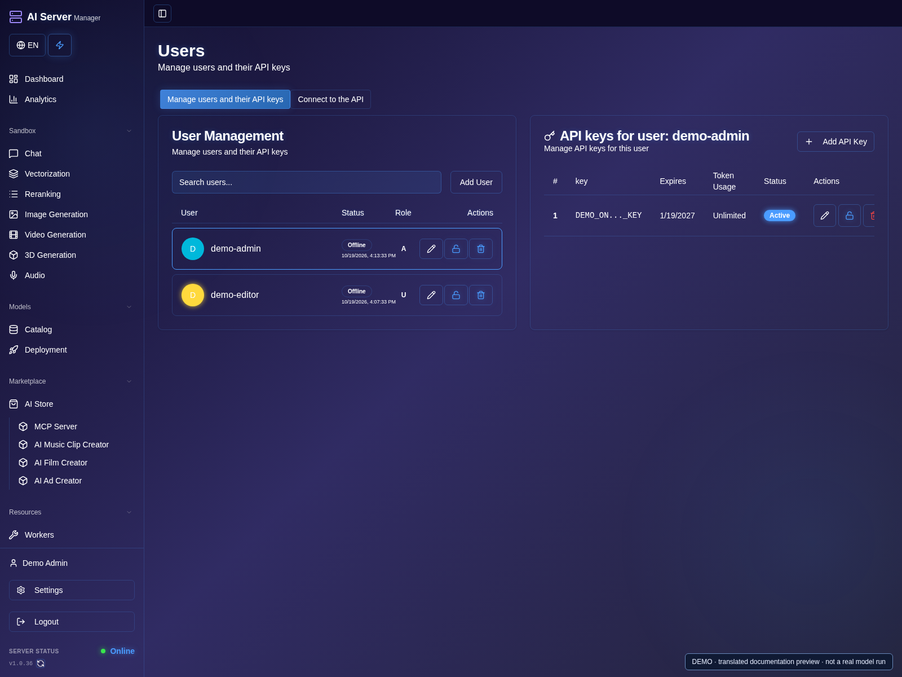
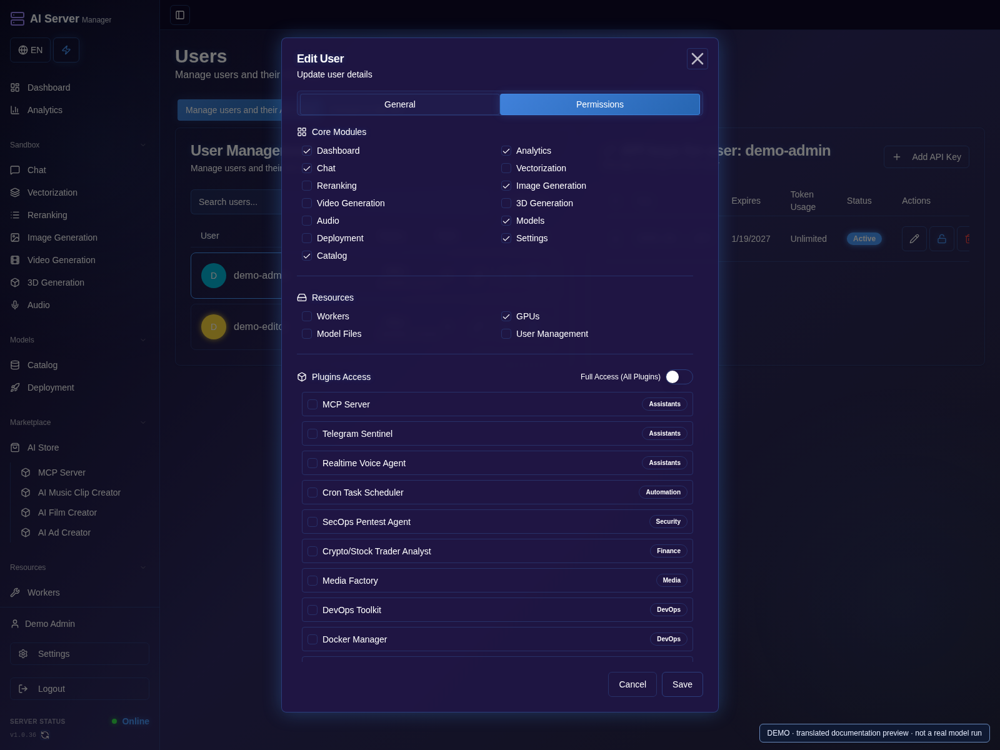
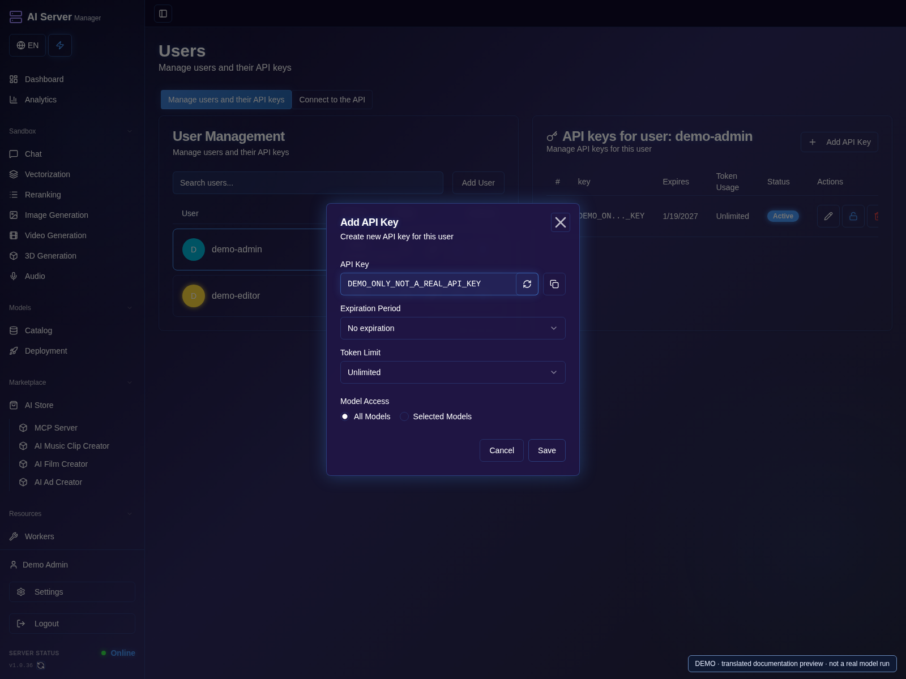

# Security and support

[Guide](README.md) · [Русская версия](../ru/security.md)

## Create a user with limited access

1. Sign in as an administrator and open **Users**.
2. Create a separate account for the person who will use the panel; do not share the administrator password.
3. Edit that user and open **Permissions**.

4. Enable only the required sections and actions, then save.
5. Test with the limited account: it should access the intended functions, not administrator controls.

## Protect API access

1. Create a different API key for each application, with the needed models and limits; record its purpose privately.
2. Keep keys out of screenshots, source files, URLs and public conversations.
3. Revoke a leaked or unused key and update the client; do not just rename the key.

## Before exposing the panel

1. Change the initial panel and recovery passwords.
2. Restrict access to trusted networks and configure HTTPS.
3. Check user permissions and application keys, then test access from the intended client.
4. Keep administrative services private and maintain a protected backup.

- Use unique administrator and recovery passwords. Change default credentials.
- Restrict network access; configure HTTPS before remote use.
- Give users and API keys only the permissions they need. Use separate keys for
  separate applications and revoke compromised credentials.
- Keep raw engine ports, updater control APIs and Docker sockets away from
  untrusted users and public networks.
- Treat remote model code, generated code and third-party extensions as code
  execution. Review them before enabling or running them.
- Download weights from sources you trust and review their license and gated
  access conditions. A panel subscription does not replace a model license.
- Back up persistent data and protect backups as carefully as live secrets.

## Reporting a problem

1. Note the panel/image version, hardware, selected model and engine.
2. Write the smallest sequence that reproduces the problem, including expected and actual behavior.
3. Copy the relevant error and redact credentials and personal data; review screenshots as well as text.
4. Submit the sanitized report through the appropriate channel below.

Use [GitHub issues](https://github.com/rjohny55/ai-server-manager/issues) for
non-sensitive problems. Include the image family/version, hardware model and
memory, model/engine, steps to reproduce and sanitized error messages.

**Never publish:** passwords, API/MCP/Hugging Face tokens, license strings,
cookies, authentication headers, `.env`, private documents, signing keys or
unreviewed log archives. Logs may contain initial passwords or user content.
Use the website's contact/support channel for sensitive reports; do not attach
secrets to a public issue.

This repository is not a place to upload application source or private builds.
Public documentation does not make proprietary software open source.
