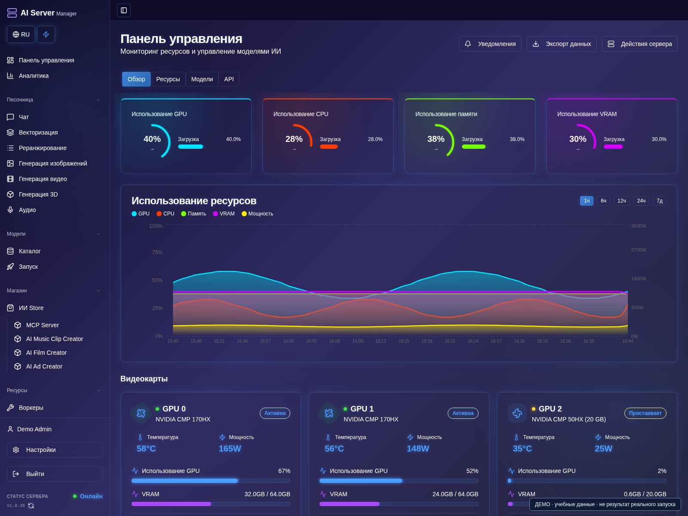

# Руководство пользователя

[English — primary version](../en/README.md) · [Главная страница](../../README.ru.md)

Для пользователей готового приложения AI Server Manager. Собирать приложение
или получать доступ к закрытым исходникам не требуется.

1. [Установка и первый вход](installation.md)
2. [Каталог, скачивание и запуск моделей](models.md)
3. [GPU и память](gpu.md)
4. [Чат, агент и API](chat-api.md)
5. [Изображения, видео, аудио и 3D](media.md)
6. [Плагины и творческие проекты](plugins.md)
7. [Обновления, лицензии и диагностика](operations.md)
8. [Безопасность и поддержка](security.md)

## С чего начать

1. Пройдите [установку и первый вход](installation.md), затем смените первоначальный пароль.
2. На главной проверьте обнаруженные GPU, свободное место и лицензию.
3. Пройдите раздел каталога и запуска, затем открывайте чат или генерацию медиа.

## О скриншотах

Во всех восьми разделах есть пронумерованные действия и снимки экранов.
Панель снята из настоящего интерфейса на изолированном стенде с учебными данными.
В английских превью переведены некоторые ещё не локализованные подписи панели;
это не объявление о выпуске перевода интерфейса. Консольные изображения —
иллюстрации. Версии, проекты, показания GPU и данные аккаунта — примеры,
а не замеры, настоящая активация или выполненные генерации. Действующих ключей
нет. Вид элементов зависит от сборки и прав. Используйте свои значения и
начинайте с небольшого теста.

**Скачано** — файлы на диске, но модель ещё не обязательно загружена в GPU.
**Готово** — движок подтвердил готовность; открытый порт сам по себе её не доказывает.
**Эксперимент** — интеграция или пресет есть, но конкретный сценарий требует
проверки на вашем оборудовании. Это не гарантия скорости или вместимости.

Версия панели, движок и веса — разные компоненты. Обновление панели не означает
автоматического перехода на новую CUDA, ROCm или vLLM.
