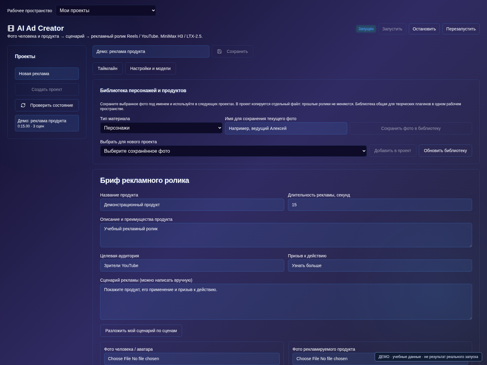

# AI Ad Creator

[Оглавление](README.md) · [Плагины](plugins.md) · [English](../en/ad-creator.md)

Реклама продукта начинается не с кнопки генерации, а с понятной задачи: что показываем, кому и зачем. Плагин **AI Ad Creator** в AI Server Manager объединяет бриф, изображения человека и товара, сценарий, видеосцены и экспорт в одном проекте. Он подходит для подготовки вариантов ролика, которые затем нужно проверить перед публикацией.

Разберём работу на примере термокружки. Характеристики в примерах — исходные данные для учебного проекта, а не рекламные утверждения о реальном товаре.

## 1. Подготовьте рабочие модели

Включите AI Ad Creator в AI Store. Плагин доступен в подписках Бизнес и Энтерпрайз с учётом версии сборки и прав пользователя.

В «Запуске» подготовьте **MiniMax H3 Ref2VA или LTX-2.5** для работы с фото. Дождитесь статуса готовности. В настройках плагина выберите эту видеомодель. Для сценария можно подключить уже запущенную LLM; для генерации изображений — подходящие Flux 2 Klein, Flux 3 Klein или Ideogram 4. Не каждый checkpoint поддерживает редактирование фото: это нужно проверить отдельно.

Если фотографии и сценарий готовы, LLM и генератор изображений необязательны. Не оставляйте ненужные модели в видеопамяти во время рендера.

## 2. Заполните бриф без выдуманных преимуществ

Создайте проект и откройте «Материалы и сценарий». Укажите название продукта, описание, целевую аудиторию и призыв к действию. Для начала выберите небольшой ролик, например 15 секунд.

Пример брифа:

> Продукт: матовая синяя термокружка объёмом 450 мл. Аудитория: люди, которые берут напиток на прогулку. Задача: показать форму, крышку и удобство повседневного использования. Не заявлять время сохранения температуры, герметичность или другие неподтверждённые свойства. Финал: «Выберите свой цвет в каталоге».

Кнопка «Заполнить проект с ИИ» помогает последовательно подготовить текст. Проверьте черновик перед применением. ИИ не знает реальных сертификатов, условий доставки и свойств товара, если вы не предоставили эти данные. Отдельные поля можно доработать вручную или с помощью ИИ, не заполняя заново весь проект.

## 3. Загрузите человека и продукт

В блоке «Человек и продукт» добавьте собственные фотографии. Для товара особенно важны чёткая форма, правильный цвет и видимые детали упаковки. Используйте фото человека с его разрешения.

Рядом с загрузкой есть кнопка с кубиком. Она открывает генерацию изображения: выберите готовую модель, введите промпт, задайте размер, шаги и доступные параметры качества. Результат можно перегенерировать, скачать или использовать. При сохранении задайте имя персонажа или название продукта, чтобы повторно находить материал в библиотеке.

Для реальной рекламы синтетическое изображение товара не должно незаметно менять его характеристики. Если модель рисует другую крышку, этикетку или пропорции, замените результат проверенным фото.

## 4. Подготовьте общий кадр

Два отдельных фото ещё не означают, что видеомодель корректно совместит их. Подготовьте изображение «человек с продуктом» и проверьте, кто держит предмет, как выглядят руки и не изменился ли сам товар. Автоматическая подготовка требует поддержки image editing выбранной моделью изображений.

Альтернативный путь — загрузить готовый общий кадр и включить «Использовать загруженный общий кадр из настроек». Это полезно, когда важно сохранить точное расположение человека и продукта.

## 5. Разложите рекламу на короткие сцены

Выберите формат: вертикальный 9:16 для Reels или горизонтальный 16:9 для YouTube. Установите поддерживаемый размер. Для первого теста достаточно трёх планов по 5 секунд. Есть режимы 10 и 15 секунд; 20 секунд и полный случайный набор требуют LTX-2.5.

Пример структуры ролика:

1. **Зацепка:** человек собирается на прогулку, термокружка стоит рядом с сумкой.
2. **Демонстрация:** крупный план кружки в руке, хорошо видны форма и крышка.
3. **Финал:** спокойный общий план с продуктом и коротким призывом к действию.

Напишите сценарий и нажмите «Разложить мой сценарий по сценам» либо подготовьте его с LLM. Сохраните проект. В каждой сцене задайте одно основное действие: не просите за пять секунд показать распаковку, прогулку, сравнительный тест и длинную речь.

Логотипы и надписи обязательно проверяйте: генеративное видео может искажать текст. Если точность критична, подготовьте итоговые титры в подходящем монтажном редакторе.

## 6. Проверьте один дубль, затем запускайте очередь

В «Сцены и таймлайн» начните с одной сцены. Просмотрите её целиком: совпадает ли товар с фото, нет ли лишних пальцев, не меняется ли цвет. Выберите удачный дубль или перегенерируйте только этот план.

Для непрерывного действия можно включить продолжение последним кадром. Помните: он заменяет обычный референс следующей сцены и может переносить ошибки. Для нового ракурса или сцены с важной упаковкой используйте проверенный исходный кадр.

Когда тест устраивает, запустите остальные сцены или полный цикл. Следите за очередью и прогрессом. После изменения текста готовые дубли не пересоздаются сами: явно перегенерируйте затронутые сцены.

## 7. Экспортируйте и проверьте рекламу

Откройте «Экспорт и результаты» и соберите рекламный ролик из выбранных дублей. Скачайте файл и просмотрите его со звуком. Плагин сохраняет звук видеомодели; если его нет, монтаж может содержать тишину. Наличие персонажа не означает автоматическую дикторскую озвучку или точный lip-sync.

Перед публикацией проверьте товар, лица, реплики, громкость и рекламные утверждения. Сохранённые экспорты остаются в истории проекта; новая версия не должна заменять единственную копию удачного результата.

## Частые вопросы

**Можно ли сделать рекламу без человека?** Да, стройте сценарий вокруг продукта и используйте подходящий референс. Не включайте этапы, требующие аватара, если он не нужен.

**Почему кнопка генерации недоступна?** Проверьте готовность выбранной модели, обязательные данные и сохранение проекта. Для генерации фото нужен генератор изображений, для видео — видеомодель; одна не заменяет другую.

**Можно ли повторно использовать персонажа и товар?** Да. Сохраните материалы в библиотеку под именами и добавляйте их в новые проекты. После импорта всё равно проверьте назначение референсов.

Смежные руководства: [музыкальный клип с ИИ](https://ai-server-manager.ru/blog/kak-sozdat-muzykalnyj-klip-s-ii), [короткометражный фильм](https://ai-server-manager.ru/blog/kak-sozdat-film-s-ii) и [локальная генерация изображений](https://ai-server-manager.ru/blog/generaciya-izobrazhenij-lokalno-sdnq).

Действия относятся к сборке 1.0.36 с доработками на октябрь 2026 года. Названия кнопок могут отличаться в более раннем образе. Иллюстрация выше показывает демонстрационный интерфейс, а не результаты генерации из этого примера.
