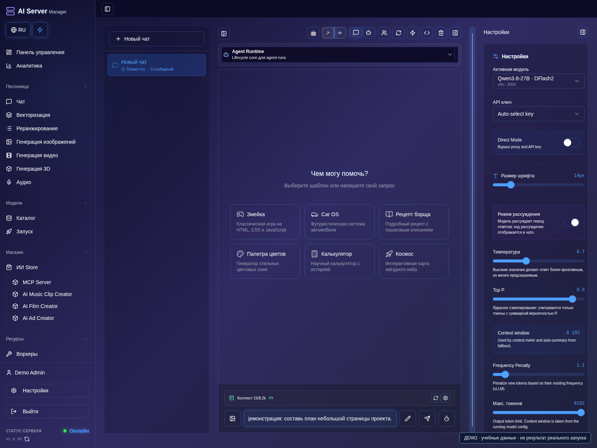
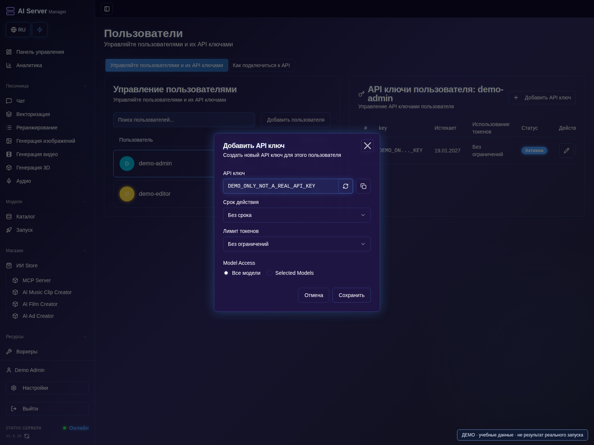
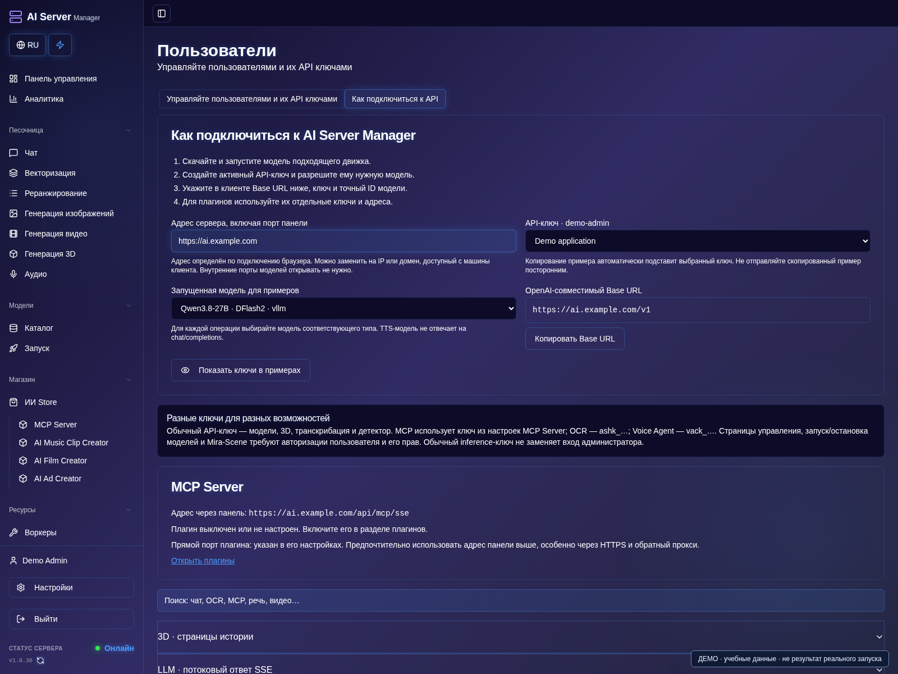

# Чат, агент и API

[Оглавление](README.md) · [English](../en/chat-api.md)

## Чат и агент

1. Запустите совместимую LLM и дождитесь состояния **Готово**.
2. Откройте **Чат**, выберите запущенную модель и обычный режим чата.
3. Напишите короткий вопрос и отправьте один раз. Если ответа нет, проверьте консоль модели.



4. Для работы с файлами переключитесь в режим агента и выберите нужное рабочее пространство.
5. Опишите небольшую задачу, проверьте план, вызовы инструментов и изменённые файлы.
6. Откройте нужный файл для проверки кода, затем проверьте превью и сохраните результат.


На снимках подготовлен ввод, а не показан выполненный запуск агента.

Запустите совместимую языковую модель, выберите её в чате и проверьте короткое
сообщение. Вложения требуют реальной поддержки движком и моделью; могут
понадобиться projector или отдельный Vision-компонент.

Инструменты агента требуют подходящей модели и параметров tool calls.
Начинайте с небольшой задачи, проверяйте план, изменения и превью.
Превью не заменяет аудит безопасности и проверку готовности к эксплуатации.

Если действие не подтверждено, сначала проверьте разговор/проект и консоль
модели. Важные результаты сохраняйте отдельно от временных представлений.

## Подключение приложений

1. Откройте **Пользователи / API-ключи** из аккаунта с правом управления ключами.
2. Нажмите **Добавить API-ключ**, задайте нужные модели, срок и ограничения.
3. Сохраните ключ и поместите секрет в защищённое хранилище. Ключ на снимке нерабочий.



4. Откройте **Как подключиться к API**, задайте доступный клиенту адрес панели и выберите запущенную модель.
5. Скопируйте Base URL и пример подходящего запроса; не раскрывайте ключ.
6. Проверьте связь небольшим запросом. Для распознавания, изображений и TTS используйте соответствующие модели и методы.



Создайте отдельный API-ключ с минимальными правами. Приватно запишите, какому
приложению выдали ключ: поле имени есть не во всех сборках. Используйте HTTPS-адрес
панели, а не открытые наружу порты движков. Не сохраняйте ключи в Git и не
используйте браузерную сессию как постоянный доступ приложения.

Идентификатор модели получите через `/v1/models`, не угадывайте по имени файла:

```bash
curl --fail-with-body "$ASM_URL/v1/models" \
  -H "Authorization: Bearer $ASM_API_KEY"
```

`ASM_URL` и `ASM_API_KEY` вы задаёте в своём окружении; действующего ключа
в репозитории нет.

Основные семейства API: `/v1/chat/completions`, `/v1/embeddings`,
`/v1/audio/transcriptions`, `/v1/audio/speech`, `/v1/images/generations`,
`/v1/video/generations`. Поля и результаты зависят от движка и модели;
OpenAI-совместимость не означает наличие всех методов у любой модели.

У MCP и специализированных плагинов могут быть свои ключи и контракты.
Асинхронное задание опрашивайте по возвращённому ID, не создавайте заново.
401/403 требуют проверки доступа; 503 может означать ещё неготовую модель.
