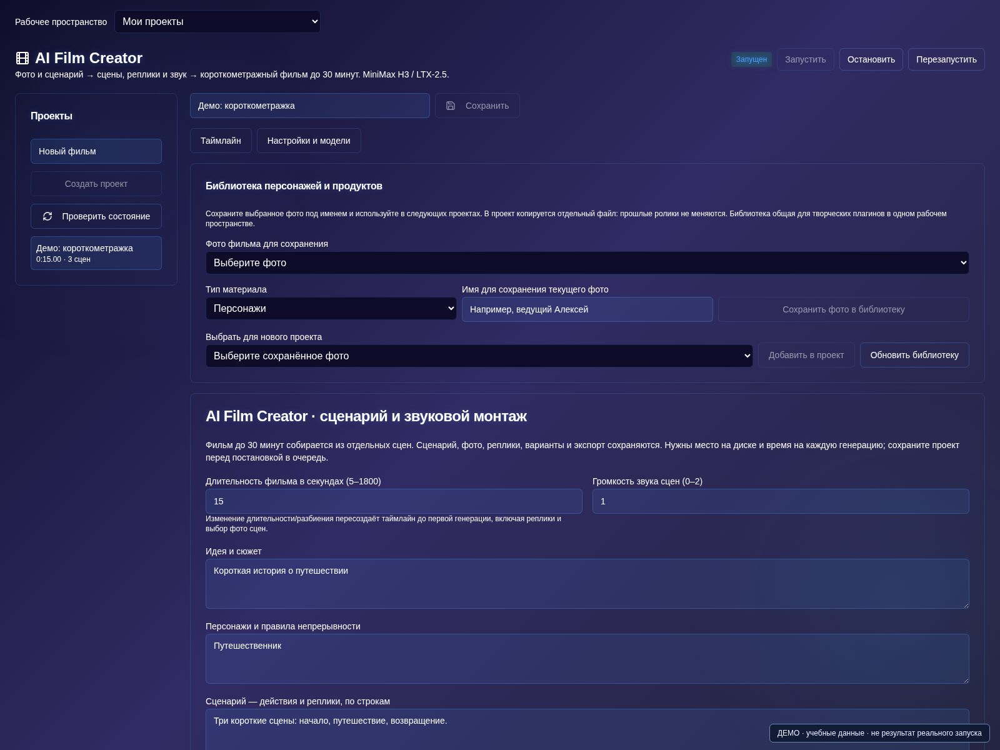

# AI Film Creator

[Оглавление](README.md) · [Плагины](plugins.md) · [English](../en/film-creator.md)

ИИ-фильм получается связным не потому, что одна модель «помнит всё кино», а благодаря подготовленному сценарию, закреплённым персонажам и проверке каждого плана. **AI Film Creator** в AI Server Manager помогает собрать такой проект: от сюжета и фотографий до сцен, звуковых вставок, готового фильма и трейлера.

В проекте можно задать длительность до 30 минут, но это не один запрос на получасовое видео. Фильм собирается из отдельных генераций. Начните с теста на 10–20 секунд: он покажет, подходит ли выбранная модель, стиль и способ работы с репликами.

## 1. Подключите необходимые модели

Включите AI Film Creator в AI Store. Плагин доступен в подписках Бизнес и Энтерпрайз в соответствующей сборке панели.

В разделе «Запуск» подготовьте MiniMax H3 или LTX-2.5 и дождитесь готовности. Для фото-референсов H3 нужен Ref2VA. Затем выберите модель в «Настройки и модели» плагина.

При необходимости подключите LLM для сценария и поддерживаемую TTS-модель для отдельной озвучки. Vision-модель или Marlin/SkyVision пригодятся для автоматического отбора сцен в трейлер, но не нужны для ручного монтажа. Запускайте только нужные сервисы с учётом свободной памяти.

## 2. Создайте небольшой сюжет

В «Материалы и сценарий» задайте длительность, формат 9:16 или 16:9, визуальный стиль и краткое содержание. Не начинайте с десятков персонажей и сложного экшена.

Пример задания для LLM:

> Короткая история в библиотеке. Анна ищет книгу, библиотекарь показывает нужную полку, Анна благодарит его. Два персонажа, одна локация, спокойная камера. Каждый план — одно действие и один говорящий. Для каждой реплики явно укажи имя персонажа. Не добавляй рассказчика и новых героев. Сначала подготовь краткий сюжет, затем планы с длительностью.

Кнопка «Заполнить проект с ИИ» готовит черновик по шагам. Проверьте его, примените и сохраните. Для длинного проекта сначала утвердите сюжет и разбиение на планы, затем заполняйте подробности. Сценарий также можно написать вручную без LLM.

## 3. Создайте персонажей и назначьте фото

Добавьте фотографии героев и локаций либо импортируйте материалы из библиотеки. Дайте понятные имена: «Анна — синяя куртка», «Библиотекарь — серый жилет». Зафиксируйте одежду и другие устойчивые признаки в описаниях.

Назначьте фото персонажам, а затем проверьте референс каждой сцены. В редакторе есть явный выбор: использовать фото, продолжить предыдущий кадр или не передавать изображение. Подсказка «Будет передано» помогает понять, какой материал действительно уйдёт видеомодели. Наличие фотографии в проекте ещё не означает её использование в конкретном плане.

Один референс не гарантирует точного воспроизведения нескольких героев. Для сложного общего плана подготовьте подходящее совместное изображение и проверьте результат отдельно.

## 4. Разделите действие и речь на посильные планы

Поддерживаются фрагменты по 5, 10 и 15 секунд; 20 секунд и полный случайный набор — для LTX-2.5. Длительность выбирайте по действию, а не только по желанию сделать меньше генераций.

Большое описание сцены не должно превращаться в один перегруженный пятисекундный кадр. Разделите его на планы: поиск книги, взгляд на полку, ответ библиотекаря, реакция Анны. У каждого — своё действие, референс и короткая реплика.

Для длинного диалога используйте «Разложить реплики на планы» или сократите текст. Перепланирование может увеличить длительность фильма; уже готовые дубли и звуковые вставки нужно проверить заново. Для другой структуры после начала генерации часто удобнее отдельный проект.

## 5. Проверьте, кто говорит, и выберите режим звука

Каждой реплике назначьте говорящего персонажа. В нативном режиме звук создаёт видеомодель, и точное распределение голосов или движения губ не гарантируется.

Если нужна более управляемая речь, выберите отдельный TTS-режим, запущенную модель и голос персонажа. Прослушайте реплику кнопкой «Синтезировать реплику» до рендера. Она должна помещаться в план. Изменение текста требует новой озвучки; старую запись нельзя считать актуальной.

TTS заменяет звук соответствующего плана, но не обеспечивает автоматическую синхронизацию губ. Для сцены с несколькими говорящими надёжнее отдельные планы, чем длинный диалог в одном кадре.

## 6. Генерируйте по порядку и выбирайте дубли

Откройте «Сцены и таймлайн» и создайте тестовую сцену. Проверьте персонажа, движение, свет и соответствие реплике. Удачный дубль выберите для монтажа; неудачный можно заменить, сохранив предыдущие варианты.

Продолжение последним кадром полезно для непрерывного действия, но может накапливать искажения. После смены локации или ошибочного кадра вернитесь к проверенному референсу. Если выбран другой дубль предыдущей сцены, уже готовая следующая сцена не обновится сама.

Поставьте предпросмотр на паузу и сохраните удачный стоп-кадр с именем в библиотеку. Затем его можно явно использовать как референс нового плана.

## 7. Добавьте музыку и звуковые вставки

Загрузите музыку, атмосферу, эффекты или готовую речь и разместите их на звуковом таймлайне. Укажите начало в фильме, отступ в исходном файле, длительность и громкость каждой вставки. Для повторения музыки добавляйте отдельные вставки: автоматическое зацикливание не подразумевается.

Не перекрывайте диалог громкой музыкой. Проверьте переходы и обрезанные окончания реплик на готовом экспорте, а не только по тексту сценария. Используйте звук и изображения, на которые у вас есть права.

## 8. Экспортируйте фильм и подготовьте трейлер

Когда для всех сцен выбраны готовые дубли, откройте «Экспорт и результаты» и соберите фильм. История сохраняет готовые версии для просмотра и скачивания. Поддерживайте резервные копии и достаточно свободного места: длинное видео требует промежуточных файлов.

Для трейлера можно вручную выбрать фрагменты готовых сцен, задать точку входа и длину каждой вырезки, переставить их и добавить отдельные музыку, эффекты и озвучку.

Есть и автоматический отбор: анализ по трём кадрам с Vision LLM либо временной видеоанализ Marlin/SkyVision с последующим планированием через LLM. Это помощь монтажёру, а не гарантия просмотра каждого кадра или проверки звука. Просмотрите предложенные вырезки и только затем экспортируйте трейлер.

## Что проверить перед публикацией

- Герои узнаваемы, а одежда и предметы не меняются без причины.
- В каждом плане понятны действие и говорящий.
- Реплики помещаются по времени и не обрываются.
- Нет чёрных кадров, заметных искажений и случайных пауз.
- Музыка не заглушает речь, выбран нужный формат кадра.

В новых сборках также предусмотрена экспериментальная LTX-постобработка: сначала сравнение одной сцены, затем отдельный обработанный экспорт. Она требует своего комплекта компонентов и совместимого GPU, может менять детали и не является обязательной частью этого руководства. Её наличие не означает проверенную совместимость со всеми картами, в частности с CMP 50HX.

## Частые вопросы

**Фильм на 30 минут появится одной генерацией?** Нет. Это проект из множества планов с последовательной генерацией и монтажом. Время зависит от моделей, длительности, разрешения и оборудования.

**Можно ли сделать всё вручную?** Да: сценарий, назначение фото, выбор дублей и монтаж не требуют LLM. Для автоматических функций нужны соответствующие готовые модели.

**Почему после изменения сценария старое видео осталось прежним?** Текст и готовый дубль — разные материалы. Перегенерируйте изменённые планы и создайте новый экспорт; прежние результаты сохраняются.

Для других задач прочитайте руководства по [музыкальным клипам](https://ai-server-manager.ru/blog/kak-sozdat-muzykalnyj-klip-s-ii) и [видеорекламе продукта](https://ai-server-manager.ru/blog/kak-sozdat-videoreklamu-produkta-s-ii).

Действия относятся к сборке 1.0.36 с доработками на октябрь 2026 года. Названия кнопок могут отличаться в более раннем образе. Иллюстрация выше показывает демонстрационный интерфейс, а не результаты генерации из этого примера.
