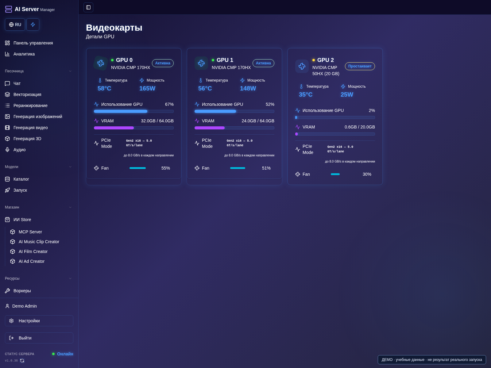
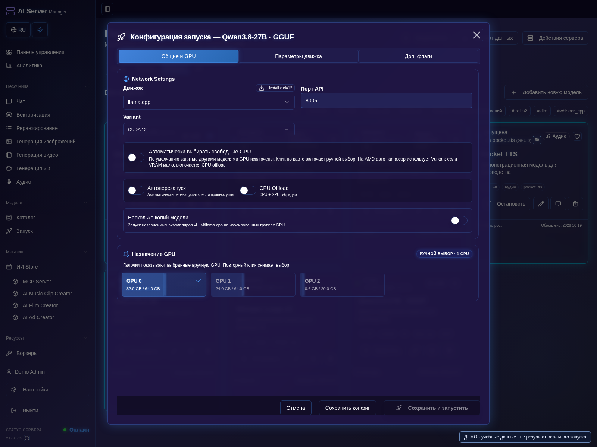
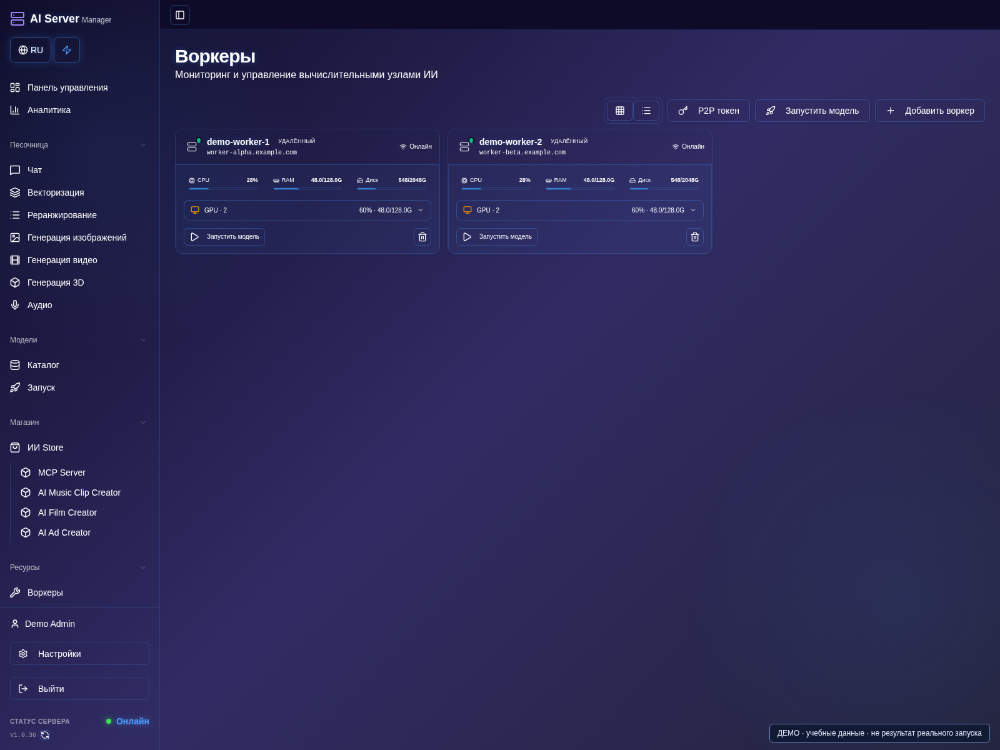
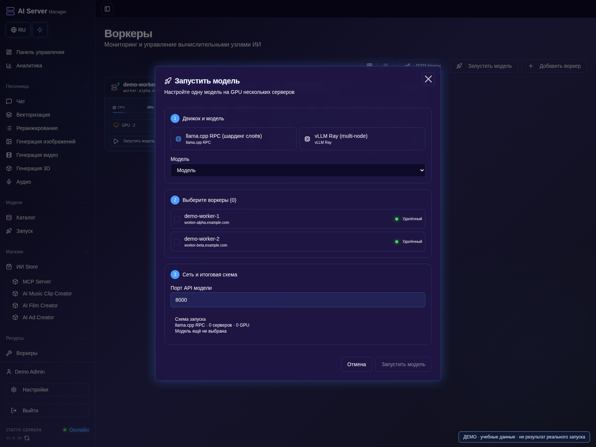
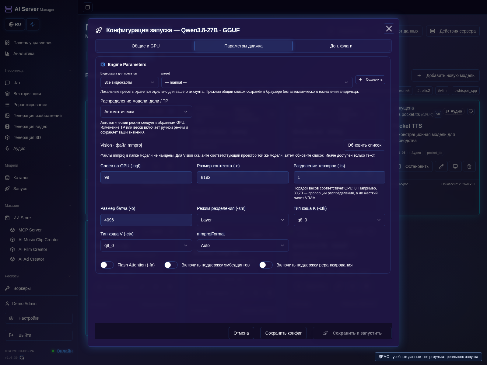

# Выбор GPU и память

[Оглавление](README.md) · [English](../en/gpu.md)

Выбор физических карт и распределение модели — разные настройки. Движок
определяет, как делить веса и вычисления. Две GPU не для каждой модели
превращаются в одну карту с суммарной памятью.

## Автоматический и ручной режимы

1. Откройте **Видеокарты**: найдите номер, название, память и сведения PCIe каждой карты.
2. Сверяйте эти номера с настройками запуска, а не с перенумерованными устройствами runtime.

3. В настройках модели оставьте автоматический выбор для назначения подходящих карт панелью.
4. Для ручного размещения выберите нужные карты и проверьте распределение в параметрах движка.
5. Сохраните, запустите и сверьте назначение по карточке и консоли модели.

Автоматический режим учитывает управляемые запуски и резервы: загружающаяся
модель уже может занимать карту. Также проверяется доступная память;
сторонний процесс способен потреблять VRAM вне панели.

В ручном режиме укажите конкретные карты. При расхождении проверьте назначения
и консоль. Логическая GPU 0 внутри движка может соответствовать другой
физической карте после фильтрации видимых устройств.

- Пропорции tensor split llama.cpp относятся к выбранным картам.
  Значения вроде `30,70` не являются настройкой TP vLLM.
- Параллелизм vLLM требует поддерживаемой топологии и архитектуры модели.
- У Hipfire и медиадвижков собственные схемы размещения.
- Vulkan и ROCm на AMD — разные пути, не взаимозаменяемые флаги.

## Кластер из нескольких серверов и P2P

1. Откройте **Воркеры**, убедитесь, что доверенные серверы онлайн и передают данные GPU.
2. Используйте поддерживаемую процедуру подключения worker; не публикуйте регистрационные ключи.

3. Откройте **Запустить модель**, выберите совместимую модель и доступную схему размещения.
4. Проверьте целевые узлы, движок и наличие весов, затем выполните небольшой тест.
5. Проверьте участие узлов по состояниям и журналам: выбор одного worker не означает распределённый запуск.

Подключайте доверенные worker-серверы через функции P2P/Workers панели, чтобы
видеть удалённые GPU и управлять поддерживаемыми распределёнными запусками.
llama.cpp RPC позволяет распределять слои модели между узлами; vLLM/Ray —
использовать поддерживаемые многоузловые схемы инференса. Запуск vLLM с tensor
parallel на одном worker сам по себе не является запуском на нескольких серверах.

Совместимость зависит от модели, сборки движка, топологии GPU и сети. Подготовьте
совместимые runtime и нужные файлы моделей на участвующих узлах, начните с
небольшого теста. Добавление серверов не объединяет CPU, ОЗУ и VRAM автоматически
и не гарантирует ускорения генерации.

P2P здесь — связь **между серверами**, а не прямой PCIe-доступ между видеокартами.
Используйте доверенные узлы и защищённый сетевой доступ; регистрационные и
управляющие ключи храните приватно.

## Память и offload

1. Начните с пресета оборудования и небольшого контекста или разрешения.
2. Если поддерживается, включите CPU/RAM offload; проверьте свободную ОЗУ вместе с VRAM.
3. Выполните один запрос, оцените пиковую память, затем увеличивайте нагрузку.

VRAM нужна не только для весов: есть KV-кеш, активации, энкодеры и декодирование.
Суммарная память карт не гарантирует, что неделимый компонент поместится.
CPU/RAM offload переносит хранение или вычисления по правилам pipeline,
но не отменяет потребность в памяти GPU.

Начинайте с небольшого контекста или короткой генерации низкого разрешения.
Проверьте каждую модель отдельно, затем запускайте несколько одновременно.
Низкая загрузка GPU при чтении файлов или text encoding не доказывает зависание.

Выбирайте поддерживаемую точность. Turing/CMP50 и MI50/gfx906 обычно требуют
FP16-совместимого пути вместо BF16. Параметр вычислений не превращает BF16-файл
GGUF в F16-веса.
