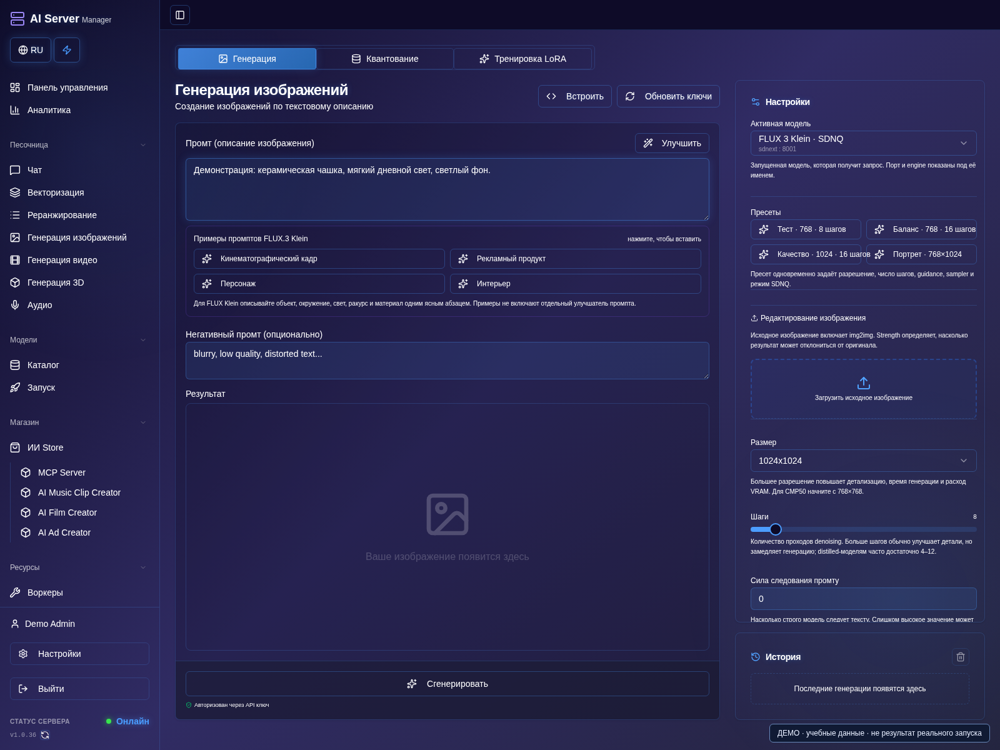
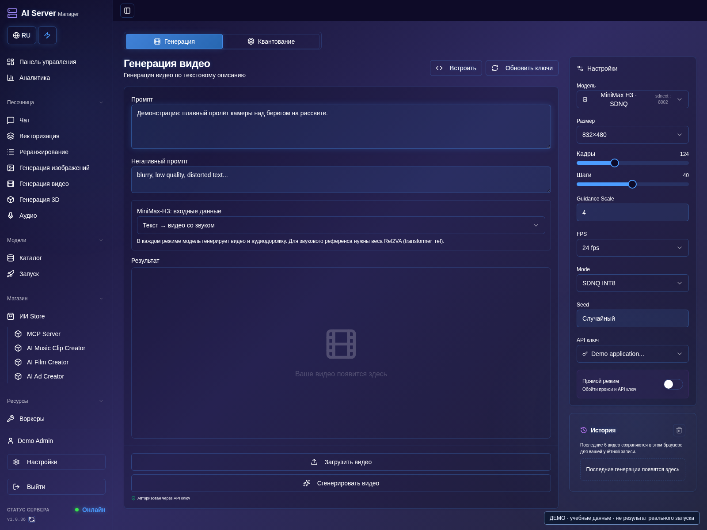
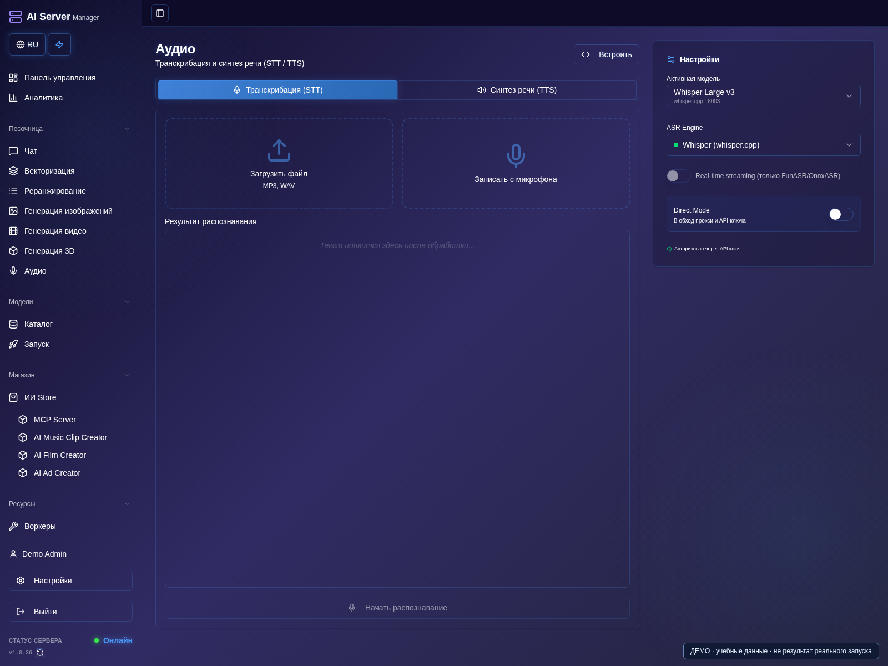
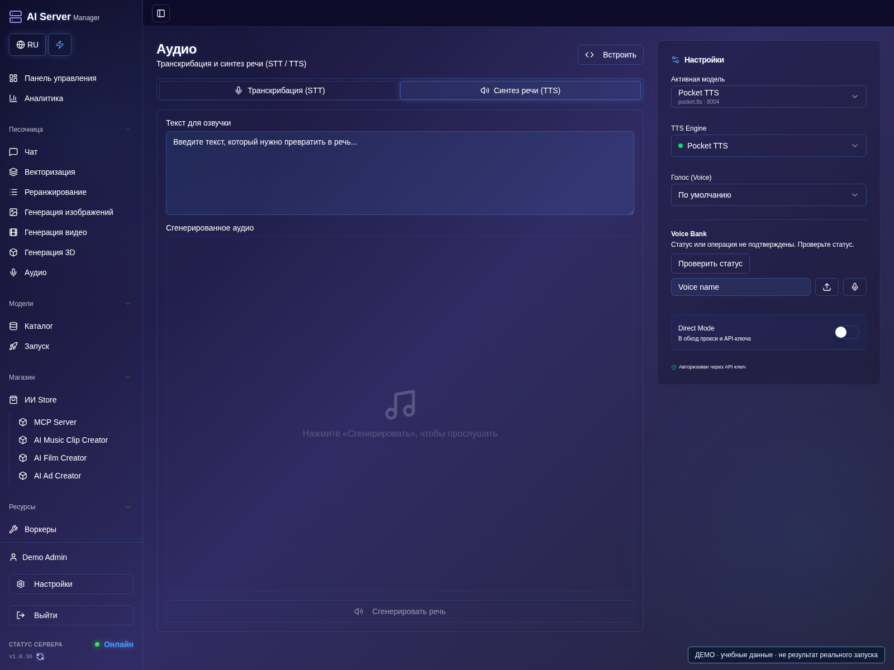
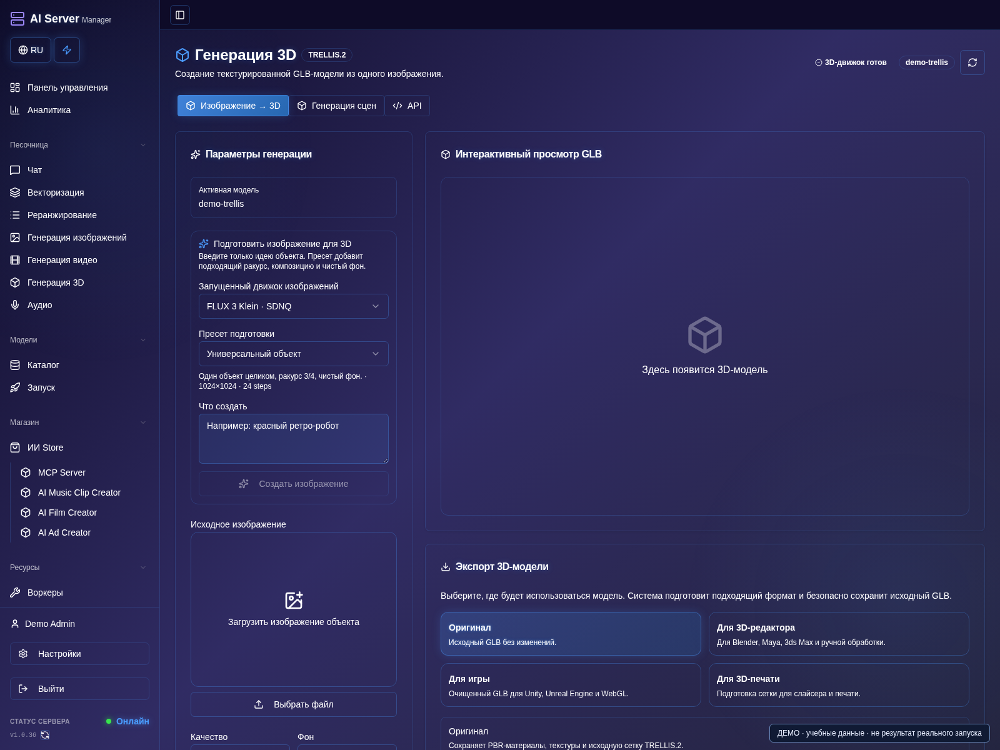

# Изображения, видео, аудио и 3D

[Оглавление](README.md) · [English](../en/media.md)

## Изображения

1. Откройте генерацию изображений и выберите готовую image-модель.
2. Примените тестовый пресет или введите промпт; проверьте ширину, высоту, шаги и seed.
3. Добавляйте референс только для совместимого режима. Улучшитель промпта оставьте выключенным, если его LLM не настроена.
4. Запустите генерацию один раз, дождитесь завершения, откройте результат и скачайте его.

Скачайте полный совместимый pipeline, примените пресет оборудования и
дождитесь готовности. Затем выберите запущенную модель в генерации изображений.
Поддерживаемые интеграции включают FLUX Klein и Ideogram.

Задайте промпт, размер, шаги и seed. Для референсов/редактирования нужны
подходящие веса. Улучшитель промпта необязателен и требует выбранной совместимой
LLM; обычной генерации он не нужен.

SDPA, FlashAttention, SageAttention и xFormers — альтернативы с ограничениями
по GPU и pipeline. Не нужно включать всё одновременно; подходящий SDPA-пресет
полезен как диагностическая отправная точка.

## Видео

1. Откройте генерацию видео и выберите готовую модель Wan, MiniMax H3 или LTX.
2. Выберите подходящие входной режим и пресет. Добавляйте фото/аудиореференс только при поддержке весами.
3. Проверьте длительность, разрешение и остальные параметры; начните с короткого небольшого теста.
4. Запустите задание, дождитесь завершения, откройте ролик в истории, воспроизведите и скачайте.

Есть поддерживаемые workflows Wan, MiniMax H3 и LTX. Выбирайте пресет для
конкретных весов, GPU и входа: текст, изображение и аудиореференс не заменяют
друг друга. Не удаляйте reference-компоненты, если будете ими пользоваться.

Сначала проверьте короткий ролик небольшого разрешения. Ограничения по размеру
и числу кадров различаются. Качество, длительность и разрешение повышают расход
памяти и время. Multi-GPU/offload работают только в поддерживаемой конфигурации.

Некоторые workflows H3/LTX генерируют звук вместе с видео. Это не универсальная
озвучка любого существующего ролика. Для проектов сцен и монтажа звука
используйте [творческие плагины](plugins.md).

## Аудио и 3D

### Распознать речь

1. Запустите поддерживаемую ASR-модель и откройте **Аудио**.
2. Выберите транскрибацию и запущенную модель; загрузите короткий файл поддерживаемого формата.
3. Укажите доступные параметры языка и вывода, начните распознавание.
4. Проверьте текст и временные метки, если они поддерживаются, затем сохраните или используйте в проекте.

### Синтезировать речь

1. Переключитесь на **Синтез речи (TTS)** и выберите запущенную TTS-модель.
2. Введите короткую фразу и выберите поддерживаемый голос или референс.
3. Начните синтез, прослушайте результат и скачайте аудио.

### Создать 3D

1. Запустите нужную 3D-модель и откройте **Генерацию 3D**.
2. Выберите модель, добавьте требуемое изображение и проверьте настройки.
3. Отправьте одно задание и дождитесь завершения; проверьте превью и доступные форматы экспорта.
4. Скачайте результат и проверьте геометрию и материалы перед дальнейшим использованием.

Распознавание и синтез речи используют собственные модели. Языки, клонирование
голоса, timestamps, диаризация и streaming зависят от движка. Сначала проверьте
короткий файл или фразу. Для чужого голоса и изображения нужно разрешение.

OCR-плагины и 3D-интеграции имеют отдельные модели и задания. Видеогенератор
не заменяет генератор 3D, а анализ видео — не его генерация. Асинхронный результат
скачивайте после завершения задания.

## История

1. После успешного задания найдите миниатюру в истории соответствующего раздела.
2. Откройте изображение для просмотра или видео для воспроизведения, затем нажмите **Скачать**.
3. При возвращении проверьте пользователя и проект, прежде чем повторно отправлять задание.
4. Экспортируйте важные файлы и резервируйте постоянные данные. Пустая история на учебных
   снимках намеренна: для руководства результаты генерации не создавались.

Истории и проектам нужно постоянное хранилище данных. Перед повтором запроса
с неизвестным исходом проверьте уже принятое задание. Экспортируйте важные
изображения, ролики и материалы; резервируйте постоянные данные.

В некоторых разделах список недавних результатов хранится в браузере: на
показанном экране видео — последние шесть роликов для этого браузера и аккаунта.
Очистка данных сайта или другой браузер могут убрать список, даже если файлы
остались на сервере. Список истории не заменяет резервную копию результатов.
