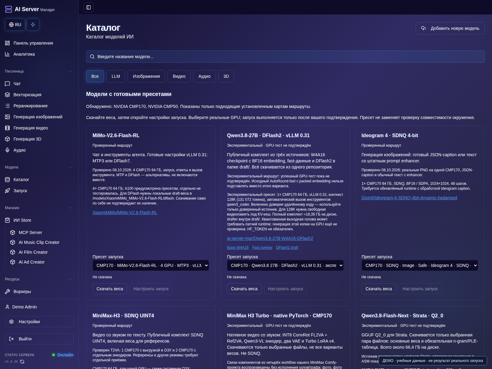
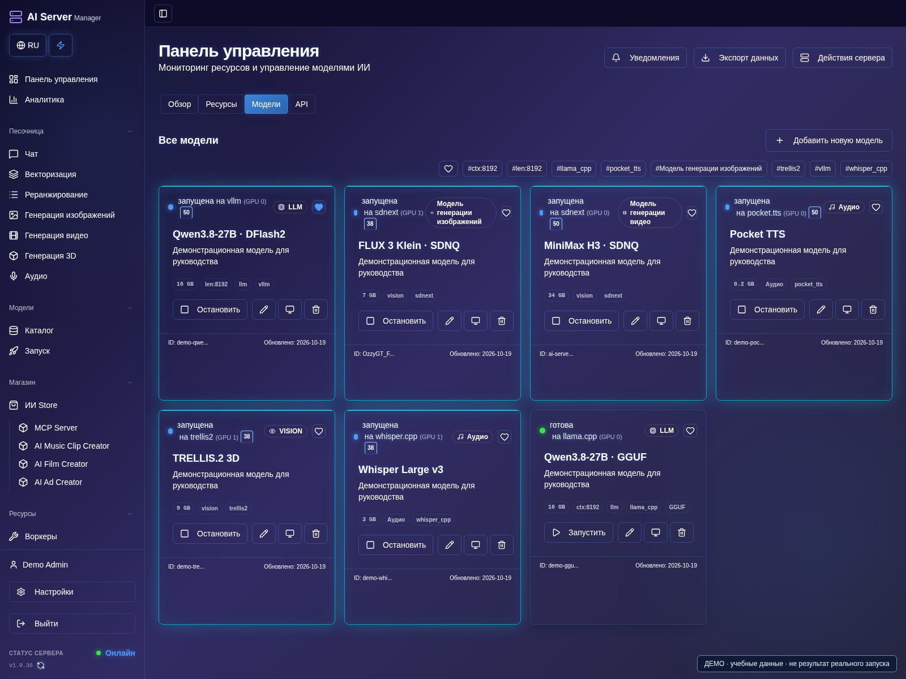

# Каталог и запуск моделей

[Оглавление](README.md) · [English](../en/models.md)

Каталог разделён на LLM, изображения, видео, аудио и 3D. Рекомендации учитывают
определённое оборудование. Пресет CMP170 не становится пресетом CMP50, а
нативные веса Hipfire — обычным GGUF.

## Скачивание

1. Откройте **Каталог**, выберите LLM, изображения, видео, аудио или 3D и проверьте фильтр оборудования.
2. Откройте карточку модели, прочитайте требования к движку, памяти и лицензию.
3. Начните скачивание полного комплекта, включая нужные draft/reference-компоненты.
4. Следите за прогрессом, затем откройте **Запуск**, когда файлы будут готовы.

- llama.cpp: совместимый GGUF и все необходимые шарды; для Vision может
  понадобиться подходящий projector.
- vLLM/1Cat: checkpoint, tokenizer и конфигурация поддерживаемой архитектуры.
  Спекулятивному декодированию может требоваться отдельная draft-модель.
- Hipfire: нативный совместимый пакет, а не переименованный GGUF.
- Strata: требуемый форматом пресета комплект и все шарды.
- Изображения/видео: полный pipeline, не только transformer.
- ASR/TTS: формат конкретного адаптера.

Для закрытых по согласию моделей Hugging Face примите условия в своём аккаунте
и добавьте токен с нужным правом чтения. Лицензия модели действует отдельно
от подписки на панель.

Прогресс относится к выбранному набору файлов. При неизвестном результате
запроса сначала проверьте существующие загрузки. Остановка и удаление файлов —
разные действия. Синхронизация с диском нужна для внешне скопированных файлов
или восстановления метаданных.

## Запуск

1. Откройте настройки скачанной модели.
2. Выберите движок, файл весов и пресет оборудования.
3. Проверьте контекст, точность, attention и память.
4. Настройте автоматический или ручной выбор GPU.
5. Сохраните, запустите и откройте консоль модели.
6. Дождитесь готовности и проверьте небольшой запрос.

### Проверьте параметры движка

1. В том же окне откройте **Параметры движка**.
2. Выбирайте поддерживаемые значения. Для llama.cpp проверьте файл весов,
   контекст и GPU/offload; у vLLM другие параметры параллелизма.
3. Дополнительные флаги выбирайте из списка своего движка и проверяйте сохранённые значения.
4. Сохраните и запустите один раз. При неподтверждённом результате проверьте консоль и карточку до повтора.

Контекст, разрешение и параллельные запросы повышают расход памяти. Удалённый
код модели включайте только для доверенного репозитория: это разрешение
исполнения кода, а не исправление несовместимых весов.
