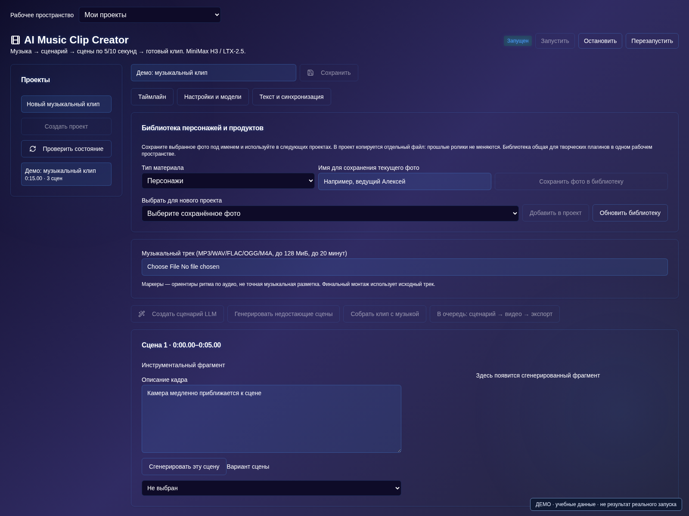

# AI Music Clip Creator

[Оглавление](README.md) · [Плагины](plugins.md) · [English](../en/music-clip.md)

Музыкальный клип можно собрать из отдельных ИИ-сцен на своём сервере: загрузить трек, подготовить визуальный сценарий, получить несколько вариантов кадров и соединить выбранные дубли с музыкой. В AI Server Manager для этого предусмотрен плагин **AI Music Clip Creator**. Он управляет проектом и монтажом, а изображение генерирует выбранная видеомодель.

Это руководство — путь от первой песни до готового файла. Для знакомства возьмите короткий трек или подготовленный отрывок: так проще проверить стиль и расход ресурсов до большого проекта.

## 1. Подготовьте модели и включите плагин

Откройте AI Store и включите AI Music Clip Creator. Плагин входит в подписки Бизнес и Энтерпрайз; доступность зависит также от установленной сборки и прав пользователя.

В разделе «Запуск» подготовьте поддерживаемую **MiniMax H3 или LTX-2.5** и дождитесь готовности. Простого выбора названия в плагине недостаточно: он не запускает видеомодель автоматически. Для работы по изображению в H3 нужен вариант Ref2VA.

Дополнительные подключения необязательны:

- LLM помогает составлять сценарий и описания сцен. При ручном заполнении она не нужна.
- Whisper или другая поддерживаемая ASR с временными метками помогает распознать слова песни.
- Генератор изображений пригодится для подготовки персонажа или первого кадра. Вместо него можно загрузить своё фото.

Не занимайте все GPU вспомогательными моделями: видеогенерации тоже нужна память. Начните с рабочего пресета своей карты. Модифицированная CMP 50HX в наших материалах рассматривается как карта с 20 ГБ, но это не означает, что любой видеопрофиль поместится на ней без выгрузки в ОЗУ.

## 2. Создайте проект и загрузите музыку

Откройте «Материалы и сценарий», создайте проект и загрузите трек, на использование которого у вас есть права. Прослушайте его до генерации: проверьте начало, конец и отсутствие ненужной тишины.

В «Настройки и модели» выберите запущенную видеомодель, при необходимости LLM и ASR. Задайте формат: вертикальный **9:16 для Reels** или горизонтальный **16:9 для YouTube**. Доступны готовые размеры и ручная настройка; выбранное разрешение должно поддерживаться видеомоделью.

Выберите длительность сцен. Для короткого теста удобно начать с 5 секунд. Есть варианты 10 и 15 секунд; 20 секунд и случайный набор 5/10/15/20 предназначены для LTX-2.5. Длинные фрагменты требуют больше памяти и времени. После генерации дублей для другой разбивки лучше создать новый проект.

## 3. Закрепите стиль и персонажа

Запишите устойчивые признаки: внешность, одежду, палитру, место и характер камеры. Загрузите референс персонажа или воспользуйтесь кнопкой с кубиком рядом с загрузкой фото. Для генерации изображения должна быть выбрана готовая модель. Проверьте результат и только затем применяйте его в проекте.

Сохраните удачное фото в библиотеку под понятным именем. Это позволит использовать его в следующих клипах и других творческих плагинах. Одинаковое имя в тексте само по себе не закрепляет внешность: важны фото и последовательные описания.

## 4. Подготовьте текст песни и сценарий

В «Текст и синхронизация» запустите распознавание либо внесите слова и интервалы вручную. Проверьте результат: вокал под музыку распознаётся не всегда точно. Разметка помогает связывать сцены со словами и ритмом, но не гарантирует синхронизацию губ.

Для помощи LLM нажмите «Заполнить проект с ИИ». Мастер составляет черновик по шагам, учитывая уже подготовленные данные. Прочитайте его, примените и сохраните. Он не подменяет настройку моделей или проверку фотографий.

Пример задания для сценария:

> Подготовь клип на 20 секунд из четырёх планов по 5 секунд. Одна героиня в красном пальто идёт по вечернему городу. Стиль — спокойная кинематографичная съёмка, тёплые витрины и отражения после дождя. В каждом плане одно действие, без новых персонажей и надписей. Финал — героиня останавливается у освещённого окна.

Такое задание задаёт структуру, а не обещает готовый результат с первого раза. Описание каждого плана можно исправить вручную.

## 5. Сгенерируйте сцены и выберите дубли

Перейдите в «Сцены и таймлайн». Сначала создайте один фрагмент и проверьте лицо, движение и стиль. Затем запускайте недостающие сцены. Предыдущие дубли сохраняются: выбирайте подходящий вариант, а не перегенерируйте весь клип из-за одного неудачного кадра.

Настройка «Продолжать с последнего кадра предыдущей сцены» помогает связать соседние планы. Она по умолчанию выключена. При включении со второй сцены последний кадр выбранного предыдущего дубля заменяет обычный фото-референс. Генерируйте по порядку. Если в кадре возник артефакт, продолжение может перенести его дальше; для новой локации часто лучше исходное фото.

Удачный момент можно поставить на паузу и сохранить кнопкой «Сохранить стоп-кадр» в библиотеку. Кадр не становится новым референсом автоматически: выберите его явно.

## 6. Соберите клип с музыкой

После выбора дублей откройте «Экспорт и результаты» и нажмите «Собрать клип с музыкой». Исходный трек используется в итоговом монтаже. Просмотрите переходы, начало и конец песни, затем скачайте экспорт. История готовых файлов остаётся в проекте при сохранённом постоянном хранилище панели.

При изменении сценария старый экспорт не обновляется сам: перегенерируйте нужные сцены и соберите новую версию. Если запрос завис или его результат неизвестен, сначала проверьте очередь, проект и консоль модели — не отправляйте одну задачу многократно.

## Частые вопросы

**Можно ли обойтись без LLM?** Да. Введите сценарий и описания вручную. Видеомодель всё равно должна быть запущена.

**Будет ли герой петь точно в такт?** Разметка текста и аудиореференс помогают постановке, но точный lip-sync не гарантируется. Аудиореференс H3 требует подходящего Ref2VA и изображения персонажа.

**Почему сцены выглядят несвязанными?** Проверьте одинаковые описания героя, свет и референсы. Не меняйте сразу место, одежду и стиль. Для непрерывного действия попробуйте продолжение последним кадром.

Дальше: [создание рекламы продукта](https://ai-server-manager.ru/blog/kak-sozdat-videoreklamu-produkta-s-ii) и [создание фильма](https://ai-server-manager.ru/blog/kak-sozdat-film-s-ii). Общие вопросы запуска разобраны в статье [о локальной генерации видео](https://ai-server-manager.ru/blog/generaciya-video-lokalno-wan-minimax-ltx).

Действия относятся к сборке 1.0.36 с доработками на октябрь 2026 года. Названия кнопок могут отличаться в более раннем образе. Иллюстрация выше показывает демонстрационный интерфейс, а не результаты генерации из этого примера.
