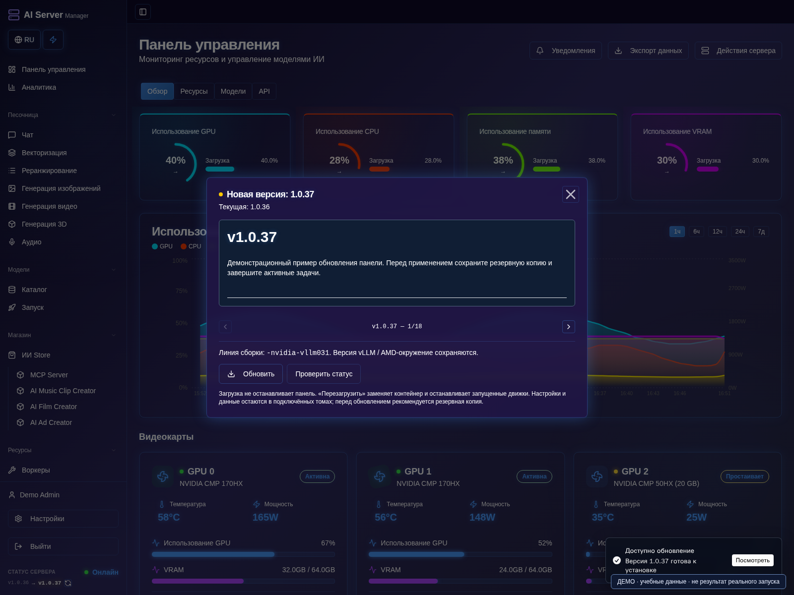
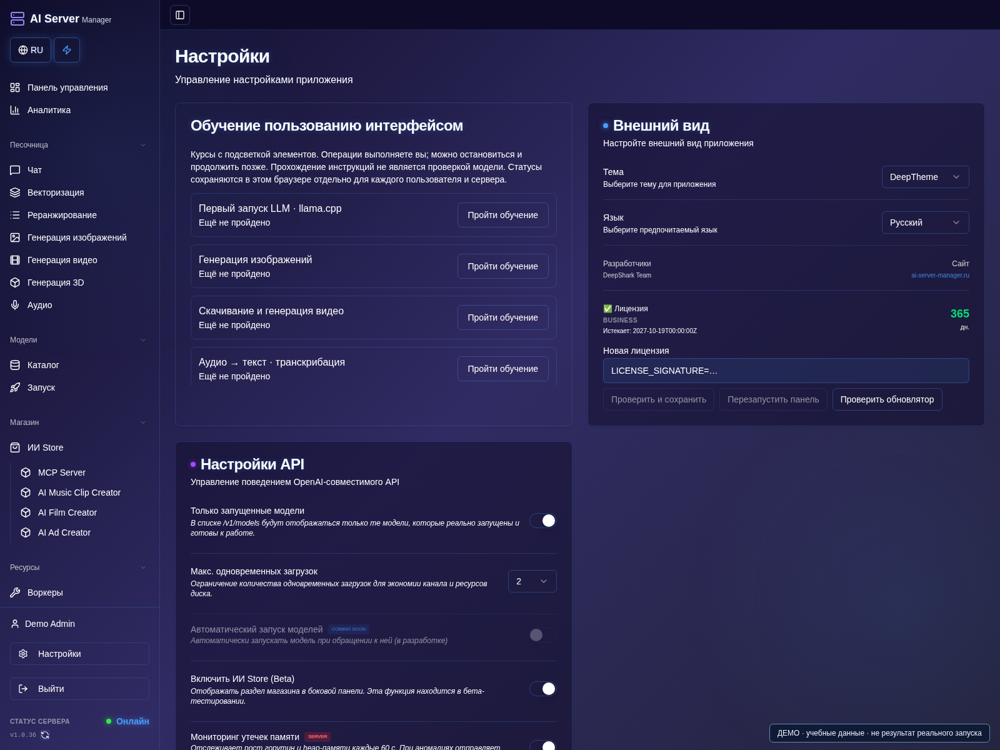

# Обновления, лицензии и диагностика

[Оглавление](README.md) · [English](../en/operations.md)

## Обновление и восстановление

1. Откройте **Настройки**, проверьте интерфейс и состояние лицензии.
2. Завершите активные задания и сделайте резервную копию до замены контейнера.

3. Откройте версию/changelog в боковом меню и прочитайте описание изменений.
4. Нажмите **Обновить**, проверьте статус обновлятора и прогресс. Если более нового образа нет, применять нечего.
5. Нажимайте перезапуск/применение только после подтверждения готовности загрузки.
6. После перезапуска проверьте доступность панели, настройки моделей и уведомление об откате, если он был.

Версия **1.0.37** на изображении — учебный ответ, а не объявление о релизе.

### Замените лицензию

1. В **Настройках** прокрутите до **Лицензии**, проверьте тариф и срок.
2. Вставьте свою новую лицензию и нажмите **Проверить и сохранить**.
3. Проверьте возвращённый тип и срок. Не перезапускайте с невалидной или неподтверждённой лицензией.
4. Проверьте доступность обновлятора, затем выполните подтверждённое действие **Перезапустить панель**.

Панель и обновлятор — разные контейнеры. Recovery-интерфейс обновлятора
помогает при недоступности панели. Настройте его по выводу установщика,
ограничьте доверенной локальной сетью и сразу смените первоначальный пароль.
Управляющий API не открывайте в интернет.

Проверка обновления доступна в окне версии/changelog. Скачивание не равно
применению. Сохраняйте семейство образа: разные поколения NVIDIA runtime
и линии ROCm — не обычная взаимозаменяемая версия панели. После обновления
проверьте готовность и результат отката, если запуск был неудачным.

Новую лицензию проверяйте и сохраняйте в настройках, затем применяйте
подтверждённый перезапуск. Невалидный ключ применять нельзя. Если сохранение
не подтвердилось, проверьте обновлятор перед повтором.

## Резервные копии

1. Завершите запись данных по документированной процедуре соответствующего приложения.
2. Скопируйте постоянные данные и конфигурацию развёртывания в защищённое место.
3. Проверьте наличие файлов проектов и настроек, отдельно проверьте восстановление.
4. Сохраняйте предыдущий рабочий образ и конфигурацию до проверки обновления.

Сохраняйте данные, метаданные моделей, проекты, Compose/окружение и состояние
обновлятора. В копиях могут быть секреты: защищайте их. Проверяйте восстановление
и права файлов. Обычный restart не перечитывает изменённое окружение —
применяйте документированную процедуру обновлятора.

## Типовые проблемы

1. Откройте консоль проблемной модели или состояние операции обновлятора.
2. Найдите первую содержательную ошибку и сопоставьте с таблицей ниже.
3. Меняйте по одному параметру; не удаляйте веса и постоянные тома только ради повтора.
4. При необходимости отправьте очищенное от секретов [обращение](security.md).

| Симптом | Что проверить |
| --- | --- |
| Процесс есть, ответа нет | Загрузку весов, готовность и первую реальную ошибку |
| 503 при загрузке | Загрузка продолжается или уже упала; не перезапускать многократно |
| Мало памяти с offload | Свободную ОЗУ, VRAM компонента, контекст/разрешение и режим |
| Активна не та GPU | Назначение и логическую/физическую нумерацию |
| Результат запроса неизвестен | Существующее задание и состояние модели до повтора |
| Не видно истории | Пользователя, проект, постоянный том и результат задания |
| Панель не поднялась после обновления | Операцию updater, readiness и откат |
| В Compose нет GPU-устройства | Реальные устройства хоста и семейство установщика |

Свободное место проверяйте именно на файловой системе Docker/моделей.
Удаление тега не обязательно освобождает общие слои. Не очищайте тома и кеш
универсальными командами вслепую: там могут быть проекты и веса.
См. [безопасное обращение в поддержку](security.md).
