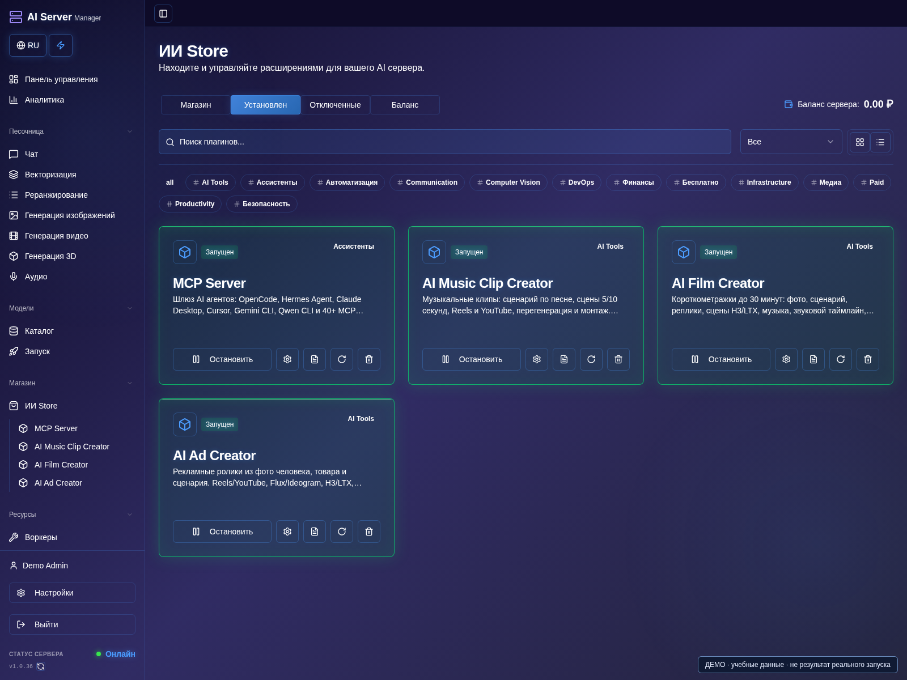
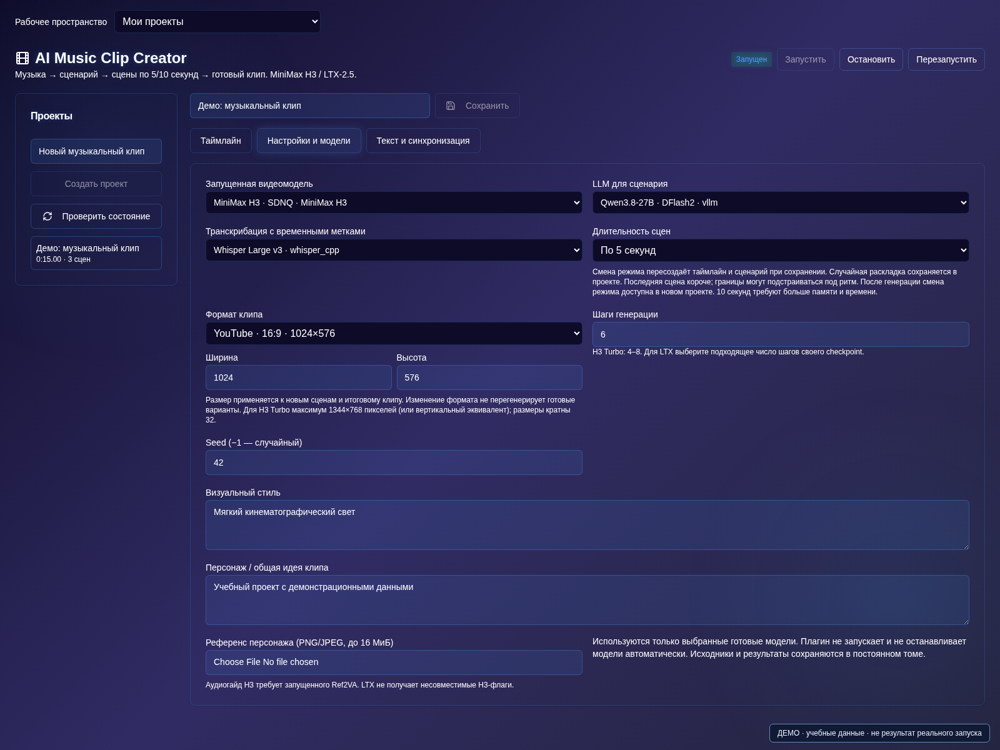

# Плагины и творческие проекты

[Оглавление](README.md) · [English](../en/plugins.md)

Полный список 19 реализованных плагинов и трёх отдельно отмеченных
запланированных записей — в [README](../../README.ru.md#список-плагинов).

Включите плагин в AI Store и выдайте необходимые права пользователю.
**AI Music Clip Creator, AI Ad Creator и AI Film Creator включены в Business
и Enterprise без дополнительной платы за плагин.** Другие плагины могут иметь
собственную цену. Доступность зависит от установленной сборки образа.

Веса скачиваются отдельно. Запустите нужные видео-, image-, языковые или речевые
модели в разделе запуска, затем выберите их внутри плагина.

## AI Music Clip Creator

### Включите плагин

1. Откройте **AI Store**, проверьте доступность и требования тарифа.
2. Включите плагин, дождитесь рабочего состояния и откройте его раздел.
3. Заранее запустите совместимые модели в **Запуске**: включение плагина не загружает веса.

### Соберите музыкальный клип

1. Создайте проект и загрузите музыкальный трек.
2. Откройте **Настройки и модели**, выберите готовую H3/LTX, при необходимости LLM и ASR с временными метками.
3. Выберите сцены по 5/10 секунд или смешанный режим, формат и тестовое разрешение; сохраните.

4. Проверьте текст и синхронизацию, создайте или отредактируйте сценарий.
5. Выберите сцену, поправьте промпт и создайте один вариант до постановки остальных в очередь.
6. Назначьте нужные варианты сцен и экспортируйте клип с музыкой.

Загрузите музыку, выберите H3/LTX и при необходимости LLM/ASR. Проверьте текст
и сценарий, выберите сцены по 5/10 секунд или смешанную разбивку. Сгенерируйте
кадры, выберите варианты и экспортируйте. Итоговый звук — исходная музыка.

## AI Ad Creator

1. Создайте рекламный проект, укажите продукт, аудиторию, преимущества и призыв к действию.
2. Загрузите фото человека/аватара и продукта либо подготовьте разрешённые материалы запущенной image-моделью.
3. Введите сценарий или используйте выбранную LLM; проверьте разбивку на сцены.
4. В настройках проекта выберите готовые модели и формат Reels/YouTube, затем сохраните.
5. Создайте короткий тест, назначьте варианты сцен и экспортируйте после проверки рекламы.

Добавьте фото человека/аватара и продукта, ручной сценарий или LLM-бриф.
Поддерживаемый image-движок может подготовить материалы и общий референс.
Проверьте его перед видео: сходство, упаковка, надписи и логотипы не гарантированы.
Выберите формат Reels/YouTube и экспортируйте рекламу.

## AI Film Creator

1. Создайте проект, задайте сюжет, персонажей и сценарий; начните с 10–20 секунд.
2. Выберите видеомодель, формат и разбиение в настройках проекта, сохраните.
3. Назначьте референсы сцен, поправьте промпты и создайте тестовый вариант.
4. При необходимости синтезируйте реплики запущенной TTS-моделью, разместите разрешённую музыку и эффекты.
5. Проверьте варианты сцен и синхронизацию звука, экспортируйте и скачайте собранный фильм.

Создайте проект до 1800 секунд, задайте формат, стиль, сюжет и персонажей.
Разложите сценарий на короткие сцены, назначьте каждой фото и отредактируйте
промпты. Для H3 с фото нужен Ref2VA.

Для реплики выберите запущенную TTS-модель и голос и выполните синтез в сцене.
Речь должна помещаться в сцену. Изменение текста снимает старую озвучку с выбора,
не удаляя файл. TTS заменяет звук этой сцены; точный lip-sync не гарантирован.
Общий pipeline не запускает TTS автоматически.

Музыку, эффекты и записанную речь разместите на таймлайне: до 32 вставок,
с началом, отступом в источнике, длительностью и громкостью. Автозацикливания нет.
Фильм собирается из множества коротких генераций, не одним запросом на 30 минут.
Сначала проверьте проект на 10–20 секунд.

## Проекты, очередь и MCP

1. Сохраните проект перед добавлением в очередь. Проверьте активное задание до создания дубля.
2. Для повторного использования сохраните материал под именем в библиотеку персонажей/продуктов и добавьте в новый проект.
3. После экспорта скачайте готовый файл; данные проектов храните в постоянном томе.
4. Для внешней автоматизации включите MCP, настройте его отдельный ключ и проверяйте состояние
   проектов и заданий через творческие инструменты до запуска или повтора. Не выдавайте внешнему агенту неограниченные ключи.

Проекты сохраняют сцены, варианты, исходники и экспорты в постоянном хранилище.
Библиотека персонажей копирует материал в новый проект, не меняя старые работы.
Используйте только материалы, на которые имеете необходимые права.

У каждого творческого плагина одна активная задача и ограниченная очередь.
При неизвестном результате сначала проверьте состояние. Отмена ожидания не
гарантирует остановку уже принятой видеомоделью генерации. После перезапуска
прерванная работа не повторяется сама, ожидавшая может продолжиться.

Creative MCP управляет проектами, настройками, загрузками, очередью и экспортом.
Для него предусмотрено отдельное пространство, не чужие личные проекты.
Передавайте ключи в заголовках, не в URL.
