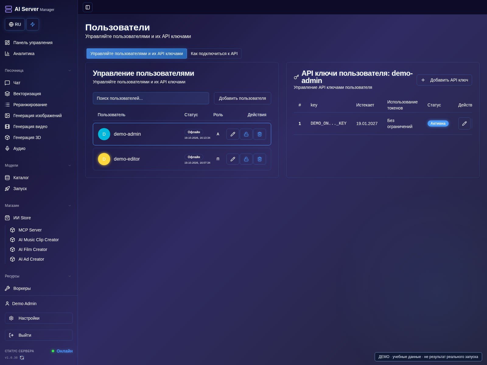
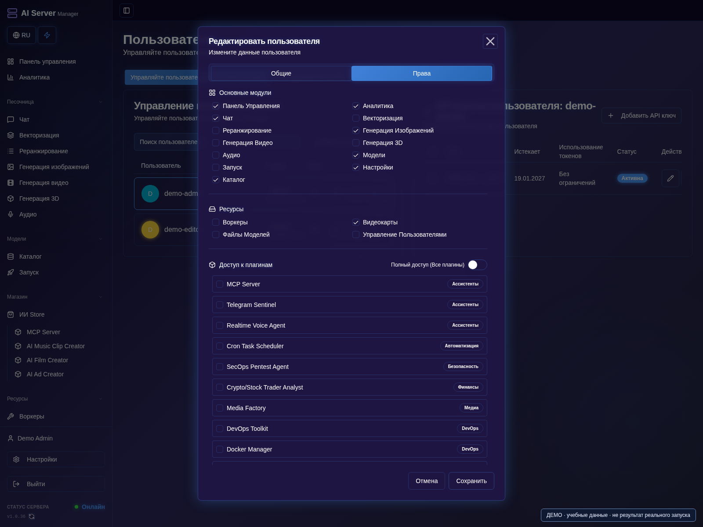

# Безопасность и поддержка

[Оглавление](README.md) · [English](../en/security.md)

## Создайте пользователя с ограниченными правами

1. Войдите администратором и откройте **Пользователи**.
2. Создайте человеку отдельный аккаунт; не передавайте общий пароль администратора.
3. Откройте редактирование пользователя и вкладку **Права**.

4. Разрешите только необходимые разделы и действия, сохраните.
5. Проверьте вход ограниченным аккаунтом: нужные функции доступны, административные — нет.

## Защитите API-доступ

1. Создавайте для каждого приложения отдельный ключ с нужными моделями и лимитами; приватно запишите его назначение.
2. Не помещайте ключи в скриншоты, исходники, URL и публичную переписку.
3. Отзовите раскрытый или ненужный ключ и обновите клиент: переименование не заменяет отзыв.

## Перед открытием доступа к панели

1. Смените первоначальные пароли панели и recovery-интерфейса.
2. Ограничьте доступ доверенными сетями и настройте HTTPS.
3. Проверьте права и ключи, затем доступ с нужного клиентского устройства.
4. Не открывайте административные службы наружу, храните защищённую резервную копию.

- Используйте уникальные пароли администратора и recovery; смените стандартные.
- Ограничьте сеть и настройте HTTPS до внешнего доступа.
- Выдавайте пользователям и API-ключам минимальные права. Для разных приложений
  используйте отдельные ключи и отзывайте скомпрометированные.
- Не открывайте недоверенным пользователям порты движков, управляющий API
  обновлятора и Docker socket.
- Удалённый код моделей, сгенерированные программы и расширения проверяйте
  перед разрешением исполнения.
- Проверяйте источник, лицензии и условия доступа к весам. Подписка на панель
  не заменяет лицензию модели.
- Резервируйте постоянные данные и защищайте копии как секреты.

## Сообщить о проблеме

1. Запишите версию панели/образа, оборудование, выбранную модель и движок.
2. Опишите минимальные шаги воспроизведения, ожидаемый и фактический результат.
3. Скопируйте нужную ошибку, уберите секреты и личные данные; проверьте также скриншоты.
4. Отправьте очищенное обращение подходящим способом ниже.

Для несекретных проблем используйте
[GitHub Issues](https://github.com/rjohny55/ai-server-manager/issues).
Укажите семейство/версию образа, оборудование и память, модель/движок,
шаги воспроизведения и очищенную от секретов ошибку.

**Не публикуйте:** пароли, токены API/MCP/Hugging Face, лицензионные строки,
cookies, заголовки авторизации, `.env`, приватные документы, ключи подписи
и непроверенные архивы журналов. В логах бывают первоначальные пароли
и пользовательские данные. Для чувствительных обращений используйте поддержку
на сайте, но не прикладывайте секреты в публичный issue.

Не загружайте сюда исходники приложения и закрытые сборки. Публичная
документация не делает проприетарное приложение открытым.
